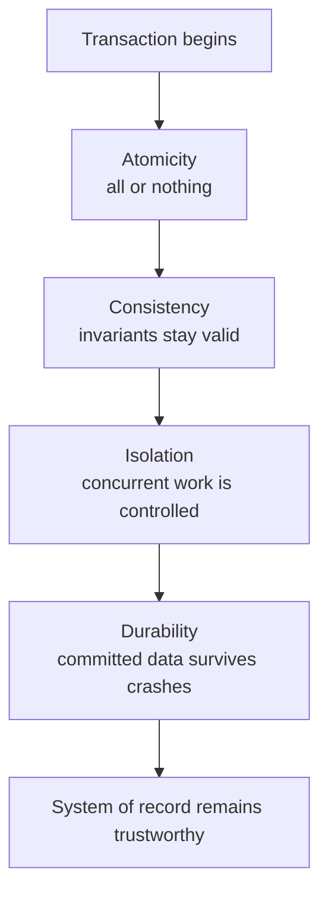
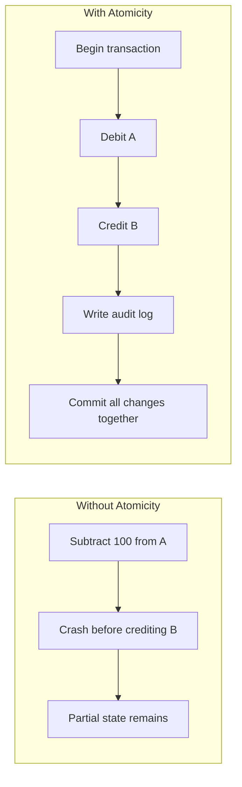
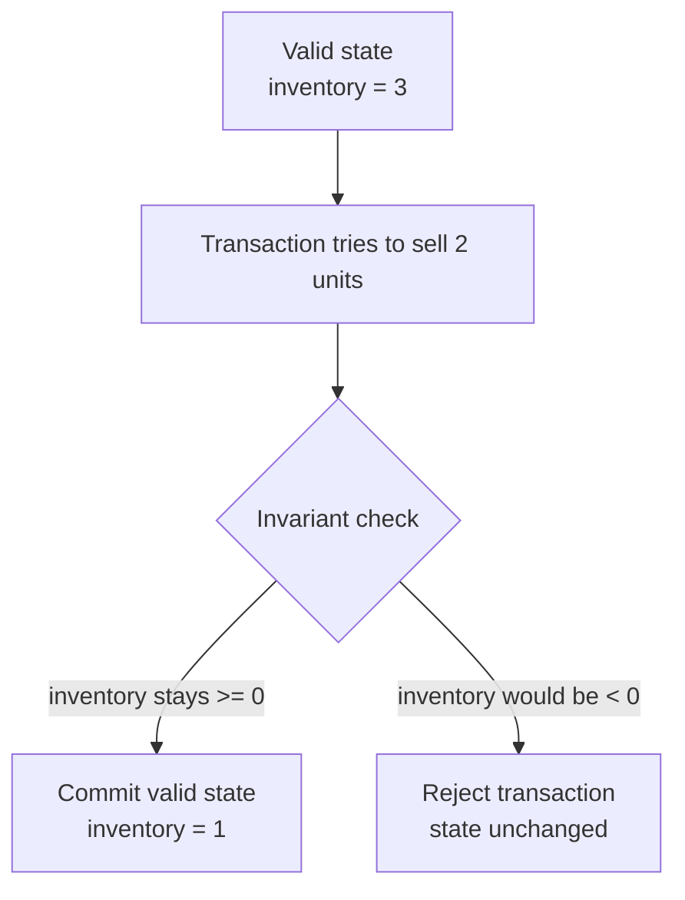
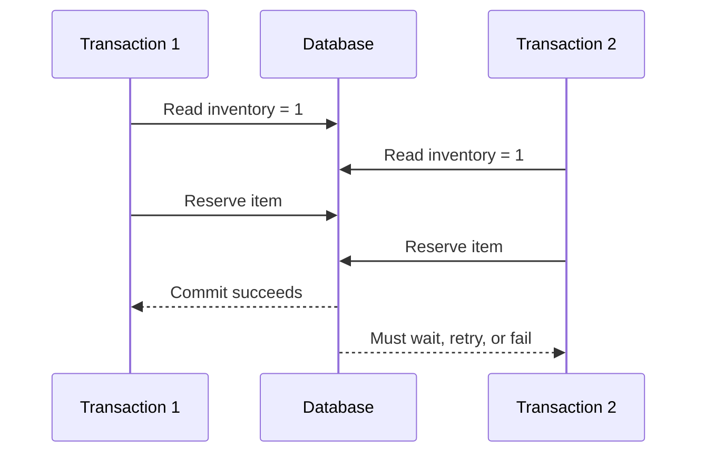
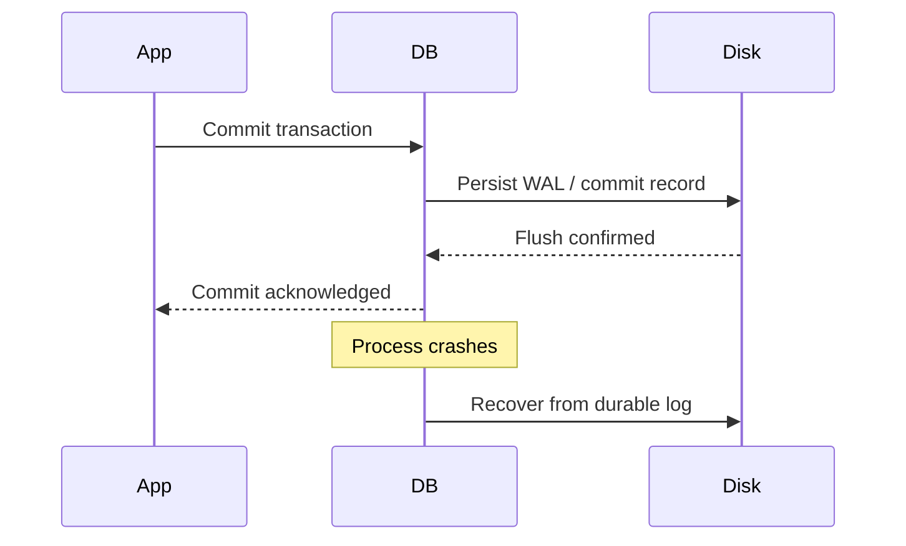
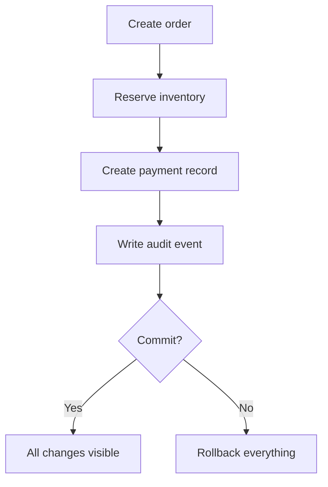

---
tags:
  - interview
  - principle
  - database
title: What is ACID
author: Huy Nguyen
pubDatetime: 2023-09-18T15:57:52.737Z
slug: what-is-acid
featured: false
ogImage: https://user-images.githubusercontent.com/53733092/215771435-25408246-2309-4f8b-a781-1f3d93bdf0ec.png
description: A practical explanation of ACID and what each transaction guarantee means in real systems.
---

## Table of contents

ACID is the contract a database offers for a transaction.

When engineers say a system is "ACID compliant," they usually mean this: the database can group multiple reads and writes into a single unit of work and provide strong guarantees about how that unit behaves, even when there are concurrent requests, crashes, or retries.

That matters because most real bugs around data are not syntax bugs. They are state bugs:

- money deducted from one account but not credited to another
- inventory sold twice
- one request reading half-finished work from another request
- a system confirming success and then losing the write after a crash

ACID exists to make those failures far less likely and easier to reason about.

## The Mental Model

A transaction is a boundary around a set of operations.

Inside that boundary, the database promises four things:

1. `Atomicity`
2. `Consistency`
3. `Isolation`
4. `Durability`

The right way to think about ACID is not "databases are magically correct." The right way is: if the application defines a valid transaction and the database is configured correctly, the engine gives predictable behavior under failure and concurrency.

## Atomicity

Atomicity means a transaction is all-or-nothing.

If a transaction contains five writes, the database does not leave you with the first three committed and the last two missing. Either the whole transaction commits, or the whole transaction is rolled back.

### Example

In a bank transfer:

1. subtract `100` from account `A`
2. add `100` to account `B`
3. write an audit record

Without atomicity, a crash between steps 1 and 2 could permanently lose money. With atomicity, either all three changes become visible, or none of them do.

### Why it matters

Atomicity is the guarantee that lets you model a business action as one unit instead of manually recovering from partial writes everywhere in the codebase.

## Consistency

Consistency means a committed transaction must leave the database in a valid state according to its rules.

Those rules can come from:

- primary key and foreign key constraints
- unique constraints
- check constraints
- triggers
- application invariants enforced inside the transaction

If the transaction would violate those rules, the database rejects it.

### Example

Suppose your schema says:

- an order must reference an existing customer
- inventory cannot go below zero

A transaction that creates an order for a nonexistent customer or oversells inventory should fail. The database should not commit invalid state.

### Important nuance

This is the most misunderstood letter in ACID.

ACID consistency does **not** mean "all replicas instantly agree" or "every read sees the latest write." That is a distributed systems topic. In ACID, consistency means preservation of invariants.

## Isolation

Isolation means concurrent transactions should not corrupt each other or observe invalid intermediate state.

If two requests hit the same rows at the same time, each one should behave as though the database has a defined concurrency policy, not random interleaving.

### Example

Assume two users both try to buy the last item in stock.

If both transactions read `inventory = 1` and both decrement it, you may end up at `-1` or oversell the item unless the database isolates those operations correctly.

Isolation prevents anomalies such as:

- dirty reads: reading uncommitted data
- non-repeatable reads: reading a different value later in the same transaction
- phantom reads: a query returning a different set of rows later in the same transaction
- lost updates: one transaction overwriting another without noticing

### Isolation is not binary

Databases expose isolation levels because stronger isolation usually costs more in throughput or latency.

Common levels include:

- `Read Committed`
- `Repeatable Read`
- `Serializable`

A staff-level design discussion should always ask: what anomaly is acceptable here, and what isolation level actually prevents it?

## Durability

Durability means once the database acknowledges a commit, that commit survives process crashes, machine restarts, and other failures the system is designed to tolerate.

In practice, databases implement durability with mechanisms such as:

- write-ahead logs
- fsync or equivalent persistence barriers
- replication
- recovery procedures during restart

### Example

If a checkout request returns `200 OK` after committing an order, that order must still exist after the database restarts one second later.

If the system can acknowledge success and then lose the write, it is not providing meaningful durability.

## A Practical Example

Consider an e-commerce checkout transaction:

1. create the order
2. reserve inventory
3. create a payment record
4. write an audit event

ACID gives you this reasoning model:

- `Atomicity`: either all four steps commit or none do
- `Consistency`: foreign keys, inventory rules, and business invariants remain valid
- `Isolation`: two customers cannot silently consume the same unit of stock
- `Durability`: once confirmed, the order survives a crash

That is why ACID is not a theory-only concept. It is the foundation for systems where money, inventory, identity, and compliance data must stay correct.

## What ACID Does Not Mean

ACID is powerful, but it does not solve everything.

It does not automatically give you:

- correct application logic
- globally consistent behavior across multiple services
- safe integration with external systems like email or payment gateways
- infinite horizontal scalability

For example, if a transaction commits and then your service crashes before publishing a Kafka event, ACID inside the database did its job. Your cross-system workflow still needs patterns such as an outbox table, idempotency keys, and retry handling.

## Tradeoffs

The cost of strong guarantees is usually coordination.

That coordination may show up as:

- locks
- retries due to serialization conflicts
- more disk I/O from transaction logs
- lower write throughput under contention

Good engineering is not about worshipping ACID or avoiding it. It is about using the strongest guarantees where correctness matters and understanding the throughput cost you are buying.

## When ACID Matters Most

ACID should be the default posture when a mistake is expensive.

Typical examples:

- payments and ledgers
- orders and inventory
- identity and permissions
- billing
- compliance-sensitive workflows

If a bad write can cost money, create legal exposure, or require manual repair, start with ACID semantics and relax only with evidence.

## Closing View

ACID is best understood as an engineering tool for keeping state transitions correct under concurrency and failure.

It is not just an interview acronym. It is the reason a database can be trusted as the system of record.
