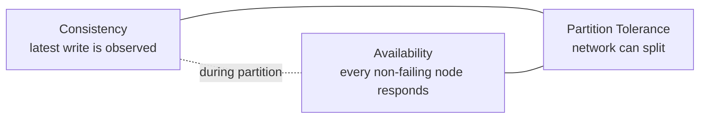
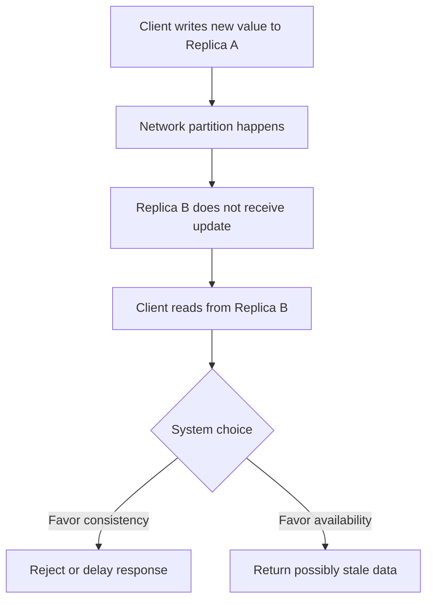
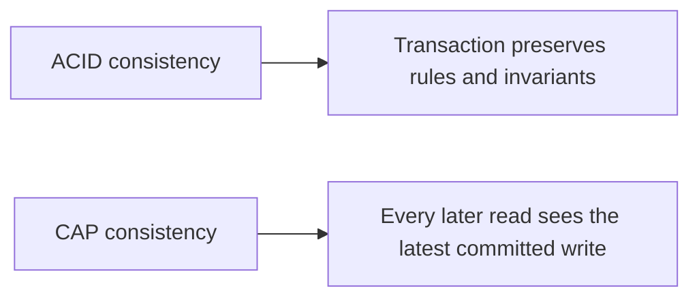
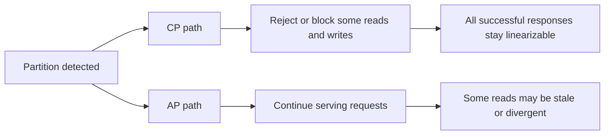
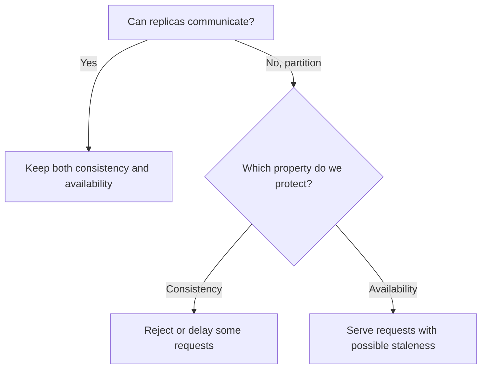
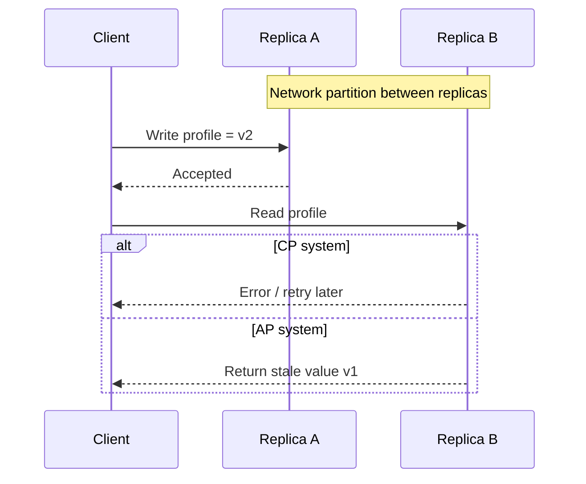

---
tags:
  - interview
  - principle
  - distributed-systems
title: What is CAP
author: Huy Nguyen
pubDatetime: 2023-09-18T15:57:52.737Z
slug: what-is-cap
featured: false
ogImage: https://creatorset.com/cdn/shop/files/Green_Screen_Word_World_Duck_saying_CAP_meme_1_-0_1920x.jpg?v=1729857071
description: A practical explanation of CAP theorem and the real tradeoff systems make during network partitions.
---

## Table of contents

CAP is one of the most repeated ideas in distributed systems and also one of the most misquoted.

The oversimplified version says: "you can only pick two out of consistency, availability, and partition tolerance."

That framing is not precise enough to guide design decisions.

The more accurate version is this:

> When a network partition happens, a distributed system has to choose between strong consistency and availability.

That is the core of CAP.

## Why CAP Exists

A single-node database does not usually force this conversation. A distributed system does, because messages can be delayed, dropped, duplicated, or split across network boundaries.

Once you replicate data across nodes, you have a new failure mode:

- node A accepts a write
- node B cannot hear about it because of a partition
- a client reads from node B

Now the system must decide what to do.

## The Three Terms

### Consistency

In CAP, consistency means **linearizability**.

If a write completes successfully, every later read must return that value or a newer one. Clients should observe one coherent, up-to-date view of the data.

This is different from ACID consistency.

- ACID consistency is about preserving invariants
- CAP consistency is about what readers are allowed to observe across nodes

Confusing those two is a common source of bad architecture discussions.

### Availability

Availability means every request to a non-failing node receives a response.

The important part is not "a successful response." The important part is that the system responds instead of blocking forever waiting for coordination that may never arrive.

That response could be:

- the current value
- a stale value
- an accepted write
- an application-level error

What CAP cares about is whether the node remains responsive.

### Partition Tolerance

Partition tolerance means the system continues operating despite communication failures between nodes.

In real distributed systems, partitions are not optional. Networks fail. Cross-zone and cross-region links degrade. Timeouts happen. Packets disappear.

That is why serious distributed systems are always designed with partitions in mind.

## The Actual Tradeoff

When there is **no partition**, many systems can provide both strong consistency and high availability.

The hard case is when a partition occurs.

At that moment, a replicated system must choose:

- `CP`: preserve consistency by rejecting or delaying some requests
- `AP`: preserve availability by serving responses that may be stale or divergent for a while

This is why "CA system" is mostly a classroom label in distributed settings. Once a partition exists, a distributed system cannot ignore it. It either handles it by sacrificing availability or by sacrificing strong consistency.

## A Concrete Example

Assume you run a service with two replicas:

- `Replica A` in zone 1
- `Replica B` in zone 2

Both store user profile data.

Now the network link between the zones fails.

### If you choose consistency

You may reject writes on one side, or reject reads that cannot be proven fresh.

That keeps all successful operations linearizable, but some clients now see failures or timeouts.

This is a `CP` choice.

### If you choose availability

You let both sides continue accepting traffic.

Clients keep getting responses, but some reads may return stale data and conflicting writes may need reconciliation later.

This is an `AP` choice.

That is the real meaning of CAP: during a partition, you do not get both.

## What CAP Does Not Say

CAP is useful, but it is narrow.

It does **not** tell you:

- how fast the system is
- how often partitions happen
- how stale reads might become
- how conflict resolution should work
- how much latency coordination adds
- whether the product can tolerate temporary inconsistency

Two systems can both be "AP" and still behave very differently in practice.

## How Engineers Actually Use CAP

Staff-level system design should use CAP as a failure-model lens, not as a branding label.

The right question is not:

- "Is this database CP or AP?"

The right questions are:

- what happens to reads during a partition?
- what happens to writes during a partition?
- do we prefer rejecting requests or serving stale data?
- how long can data diverge?
- how will conflicts be resolved?
- what is the business cost of stale reads versus temporary unavailability?

Those questions are operationally meaningful. "Pick two" is not.

## Real-World Intuition

Different product domains make different choices.

### Prefer consistency

Systems often lean toward consistency when the cost of stale or conflicting data is high:

- payments
- inventory reservation
- access control
- leader election

If two nodes disagree about a bank balance or whether a lock is held, the damage can be serious.

### Prefer availability

Systems often lean toward availability when serving something is better than failing:

- social feeds
- caches
- recommendation systems
- analytics dashboards

If one user sees a slightly stale follower count for a few seconds, that may be acceptable.

## CAP and Modern Databases

Modern systems often expose this tradeoff as configuration rather than a fixed identity.

Examples include:

- quorum reads and writes
- leader-based replication
- follower reads
- tunable consistency levels
- conflict-free replicated data types in specialized systems

That is why reducing a database to a single CAP label is often misleading. The practical answer depends on topology, read path, write path, quorum policy, and failure scenario.

## CAP Versus ACID

ACID and CAP answer different questions.

`ACID` asks:

- how does one transaction behave inside a database?

`CAP` asks:

- what does a replicated system do when nodes cannot communicate?

A system can care about both at the same time. For example, a database may provide ACID transactions on each node while still making CAP tradeoffs across replicas during partitions.

## Closing View

CAP is not a slogan about choosing any two properties you like.

It is a precise statement about the cost of replication under network failure: when partitions happen, you must choose whether to preserve strong consistency or remain fully available.

That framing is what makes CAP useful in real architecture work.
