---
tags:
  - database
  - internals
  - data-structures
  - indexing
title: "The Anatomy of Database Indexing: B-Trees and B+ Trees"
author: Huy Nguyen
pubDatetime: 2026-07-06T13:10:00Z
slug: understanding-b-trees-in-databases
featured: true
ogImage: /assets/b_tree_fun_cover.jpg
description: "A hardware-first guide to B-Trees and B+ Trees: why databases use them, how pages split and merge, how B+ Trees support range scans, and how real engines manage pages, latches, and buffer pools."
---

## Table of contents

---

A database index is not mainly about making comparisons faster. CPU comparisons are cheap. The expensive part is finding the right bytes on storage.

If a query needs one row from a table with millions of rows, the database does not want to scan every page. It wants a small, predictable path from the search key to the page that contains the row. That is the job of a B-Tree family index.

B-Trees are designed around one physical fact: disks and SSDs move data in pages, not individual keys. A good index shape should therefore make each page read count. Instead of storing one key per node like a binary tree, a B-Tree stores many sorted keys per node. One page read can eliminate hundreds of branches at once.

That high fan-out is the whole trick.

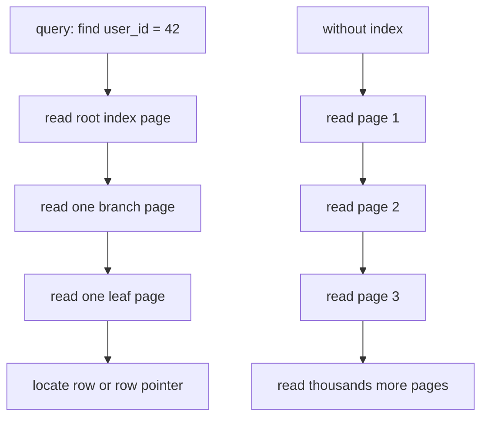

This article builds the idea from the hardware upward: why binary trees are a bad fit for disk, how B-Trees stay shallow, why production databases usually prefer B+ Trees, and what has to happen inside the storage engine to make the structure durable and concurrent.

---

## The Hardware Problem

Storage is slow compared with memory, and memory is slow compared with CPU cache.

Approximate latency numbers are enough to see the shape of the problem:

| Operation             | Approximate latency |
| :-------------------- | :------------------ |
| L1 cache reference    | `~0.5 ns`           |
| Main memory reference | `~100 ns`           |
| SSD random read       | `~10-100 us`        |
| HDD seek              | `~3-10 ms`          |

The exact numbers vary by machine, drive, controller, workload, queue depth, and cache state. The important part is the gap. A random storage read is not a slightly slower memory access. It is thousands to millions of times slower than a CPU cache hit.

Databases organize persistent storage into fixed-size pages, commonly `4 KB`, `8 KB`, or `16 KB`. Even if the query needs a single integer, the storage engine reads a whole page into memory. That page becomes the unit of caching, eviction, checksumming, write-ahead logging, and recovery.

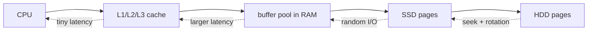

This changes how we should think about indexes. The question is not "how many comparisons does the search need?" The question is "how many pages must the database read before it can answer?"

A table scan reads page after page until it finds the row or proves the row does not exist. That is fine for analytics queries that need much of the table anyway. It is terrible for point lookups and small range lookups.

An index is a compact search structure that maps keys to row locations. Instead of scanning all table pages, the database traverses a few index pages and lands near the answer.

---

## Why Binary Trees Fail on Disk

A balanced binary search tree looks attractive in memory. It gives `O(log N)` search, insert, and delete. For `10,000,000` keys:

```text
log2(10,000,000) ~= 24
```

Twenty-four comparisons is nothing for a CPU.

Twenty-four random page reads is a different story.

In a normal binary tree, each node holds one key and two child pointers. Nodes are usually allocated independently. They may be close together in memory, or they may not. If the tree is persisted to disk naively, following a child pointer can jump to a different page for almost every level.

Think about what a pointer means in two different places.

In RAM, a pointer is an address. The CPU can follow it quickly, even if the next object is not beside the current object. On disk, the same idea becomes a page reference. The engine must read the page that contains the child node before it can continue the search.

For example, to find `37`:

1. Read the page containing `50`.
2. Compare `37 < 50`, so follow the left child.
3. Read the page containing `25`.
4. Compare `37 > 25`, so follow the right child.
5. Read the page containing `37`.

The problem is not the number of comparisons. The problem is that each comparison may require a new page read, and each page read depends on the result of the previous one.

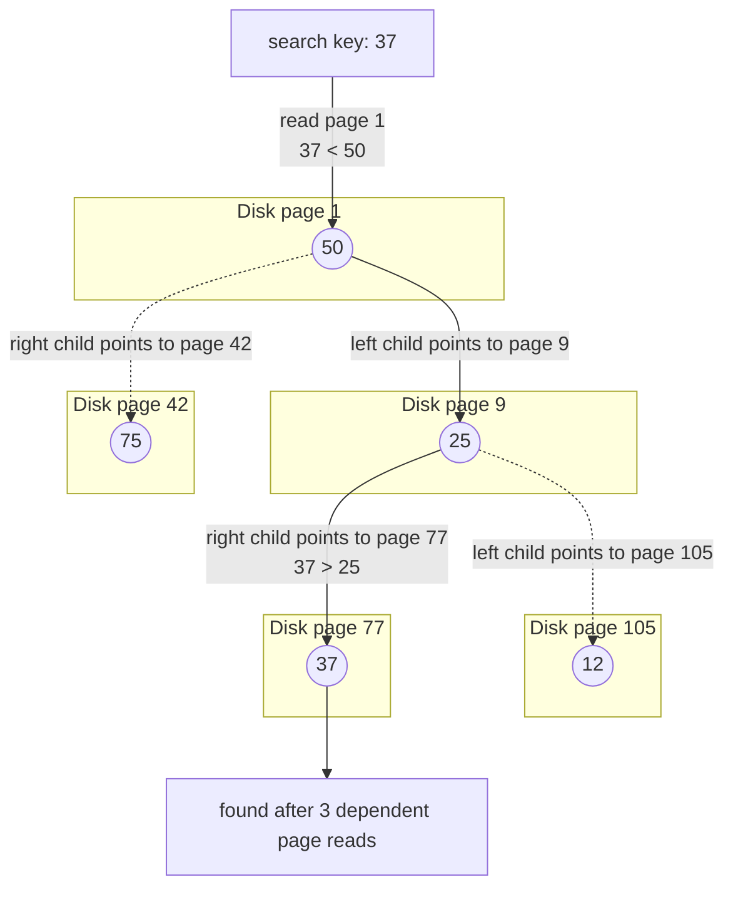

This is called pointer chasing. Each pointer is a dependency: the database cannot know which page to read next until it reads the current page and inspects the key. On disk, that means a sequence of random reads.

For a lookup through a height-24 binary tree:

```text
24 random SSD reads at 16 us each ~= 384 us
24 random HDD seeks at 10 ms each ~= 240 ms
```

Those numbers are for one lookup, before considering contention, cache misses, decompression, visibility checks, or transaction rules. A busy database cannot afford to spend dozens of random I/Os on every indexed lookup.

The deeper problem is that a binary tree wastes the page. If a page is `16 KB`, and a binary-tree node stores one key plus two pointers, most of the page is not helping the current decision. The storage device already paid the cost to read the page, so the index should pack the page with useful routing information.

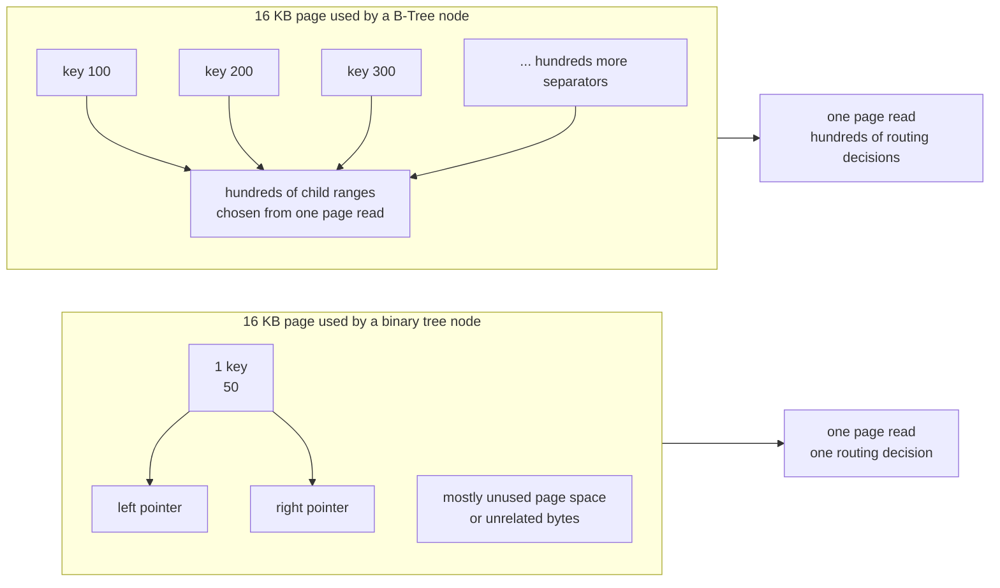

That is exactly what B-Trees do.

---

## The B-Tree Idea

A B-Tree node stores many sorted keys and many child pointers.

Instead of asking one yes/no question per page, a B-Tree page asks: "Which of these hundreds of key ranges should we follow?"

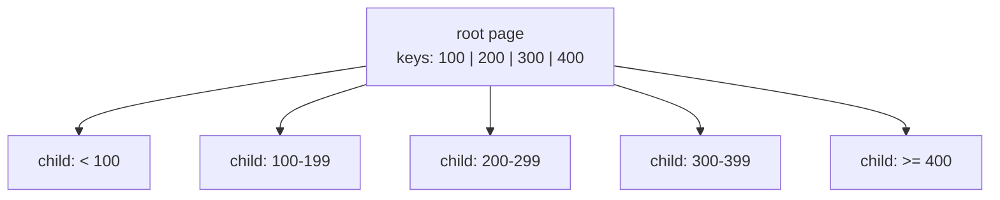

A B-Tree of order `m` is a balanced search tree with these properties:

- Each node has at most `m` children.
- Each internal node except the root has at least `ceil(m / 2)` children.
- A non-leaf node with `k` children stores `k - 1` separator keys.
- Keys inside each node are sorted.
- All leaves are at the same depth.

Terminology can be confusing because textbooks sometimes use "order" and "minimum degree" differently. In database discussions, a practical definition is:

```text
order m = maximum number of children in a node
```

If an internal node can contain `512` child pointers, one page can choose among `512` next pages. That is fan-out.

Suppose a page is `16 KB`, and a key plus child pointer takes around `32` bytes. A rough maximum fan-out is:

```text
16,384 bytes / 32 bytes = 512
```

Even if we use half-full nodes for a conservative estimate, the effective branching factor is around `256`. For `10,000,000` records:

```text
log256(10,000,000) ~= 3
```

So the search path can be about three page reads: root, branch, leaf. In real databases, the root and upper branch pages are often hot and stay in the buffer pool. Many lookups therefore need only one physical read, or none if the leaf is cached too.

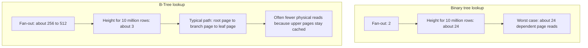

The asymptotic notation still says `O(log N)`, but the base of the logarithm matters enormously. `log2(N)` and `log512(N)` are both logarithmic. They do not have the same storage behavior.

---

## Searching a B-Tree

A search has two levels of work:

- Inside a page, find the first key greater than or equal to the target.
- Between pages, follow the child pointer for the matching key range.

Inside the page, the database can use binary search over the sorted key array. Some engines use variations such as interpolation, prefix compression-aware search, or SIMD-friendly layouts, but the mental model is binary search inside a page.

This C-style pseudocode shows the real idea better than an object graph: the tree does not follow memory pointers. It follows `page_id`s through the buffer pool.

```c
typedef uint64_t page_id_t;

typedef struct {
    page_id_t page;
    uint16_t slot;
} record_id_t;

typedef struct {
    bool is_leaf;
    uint16_t key_count;
    key_t keys[MAX_KEYS];

    // Internal page: children[i] is the page to follow for a key range.
    page_id_t children[MAX_KEYS + 1];

    // Leaf page: values[i] points to the table row for keys[i].
    record_id_t values[MAX_KEYS];
} btree_page_t;

bool btree_search(buffer_pool_t *bp,
                  page_id_t root_page_id,
                  key_t target,
                  record_id_t *out)
{
    page_id_t current = root_page_id;

    for (;;) {
        // Fetch pins the page. It may be a cache hit, or it may read from disk.
        page_frame_t *frame = buffer_pool_fetch(bp, current);
        btree_page_t *page = (btree_page_t *)frame->data;

        if (page->is_leaf) {
            // Leaf page: keys represent actual values. Search using lower_bound.
            int i = lower_bound(page->keys, page->key_count, target);
            bool found = i < page->key_count && key_equal(page->keys[i], target);
            if (found) {
                *out = page->values[i];
            }

            buffer_pool_unpin(bp, frame);
            return found;
        }

        // Internal page: keys act as separators (minimum keys of their right subtrees).
        // Use upper_bound to choose the correct child pointer.
        int i = upper_bound(page->keys, page->key_count, target);
        page_id_t next = page->children[i];
        buffer_pool_unpin(bp, frame);
        current = next;
    }
}
```

The important line is `current = next`. After one page is read, the search chooses exactly one child page. With a binary tree, that child decision usually eliminates only half the remaining keys. With a B-Tree page, the same page read can choose among hundreds of child ranges.

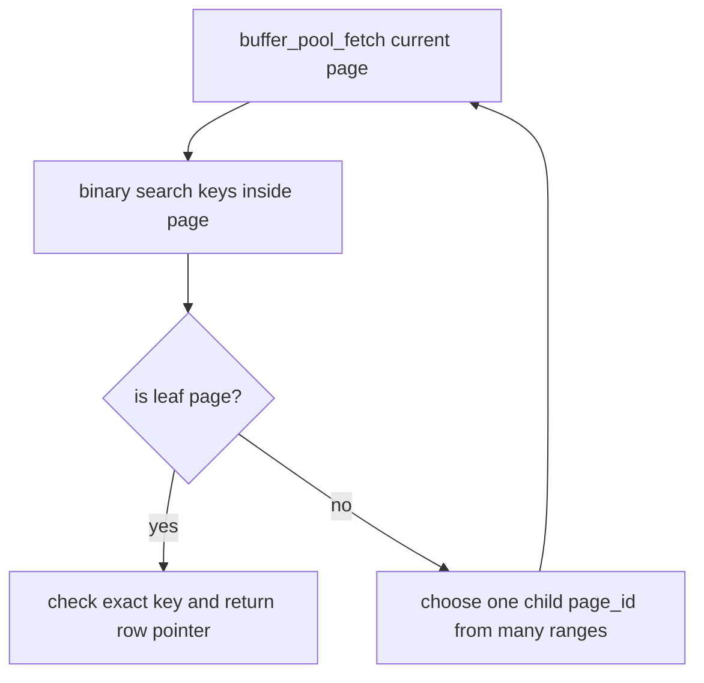

The buffer-pool call is the production detail. The page may already be in memory. If it is not, the buffer pool reads it from disk, pins it so it cannot be evicted during the operation, and returns a latchable in-memory frame.

---

## Insertion and Splitting

Insertion starts like search: walk from the root to the leaf where the key belongs. Insert the key into the sorted position. If the leaf still fits in one page, the operation is local.

The interesting case is overflow.

Every page has a maximum capacity. If a node exceeds that capacity, the tree splits the node into two nodes and promotes a separator key to the parent.

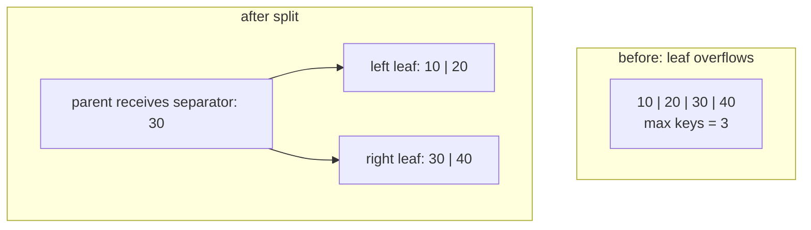

The exact separator rule differs between B-Trees and B+ Trees:

- In a standard B-Tree, the median key may move up into the parent and disappear from the child.
- In a B+ Tree, leaf data stays in leaves. The parent receives a copy of the first key in the new right leaf as a routing separator.

A practical insertion flow looks like this in page-oriented pseudocode:

```c
typedef struct {
    page_id_t page_id;
    int child_index;
} path_entry_t;

bool btree_insert(btree_t *tree, key_t key, record_id_t value)
{
    path_entry_t path[MAX_TREE_HEIGHT];
    int depth = 0;
    page_id_t current = tree->root_page_id;

    // 1. Descend to the leaf. Keep the parent path because a split may
    // need to install a separator into the parent page.
    for (;;) {
        page_frame_t *frame = buffer_pool_fetch(tree->bp, current);
        btree_page_t *page = (btree_page_t *)frame->data;

        if (page->is_leaf) {
            int pos = lower_bound(page->keys, page->key_count, key);
            leaf_insert_at(page, pos, key, value);
            mark_dirty(frame);
            buffer_pool_unpin(tree->bp, frame);
            break;
        }

        // Internal page: find the correct child range using upper_bound.
        int pos = upper_bound(page->keys, page->key_count, key);
        path[depth++] = (path_entry_t){
            .page_id = current,
            .child_index = pos,
        };

        current = page->children[pos];
        buffer_pool_unpin(tree->bp, frame);
    }

    // 2. If the leaf overflowed, split it. The split creates a new right
    // page and returns the separator key that must be inserted upward.
    page_id_t left_id = current;
    key_t separator;
    page_id_t right_id;

    while (page_is_overfull(tree->bp, left_id)) {
        split_result_t split = split_page(tree, left_id);
        separator = split.separator;
        right_id = split.right_page_id;

        if (depth == 0) {
            tree->root_page_id = create_new_root(
                tree,
                separator,
                left_id,
                right_id
            );
            return true;
        }

        // 3. Install the separator into the parent. If the parent overflows,
        // the loop repeats and pushes a separator further upward.
        path_entry_t parent_ref = path[--depth];
        page_frame_t *parent_frame = buffer_pool_fetch(tree->bp, parent_ref.page_id);
        btree_page_t *parent = (btree_page_t *)parent_frame->data;

        internal_insert_child(
            parent,
            parent_ref.child_index,
            separator,
            right_id
        );

        mark_dirty(parent_frame);
        buffer_pool_unpin(tree->bp, parent_frame);

        left_id = parent_ref.page_id;
    }

    return true;
}
```

Splits can propagate upward. If the parent overflows after receiving the separator, the parent splits too. If the root splits, the tree grows by one level. This is why B-Trees remain balanced: they grow at the root, not by making one side deeper than the other.

There are two common implementation styles:

- Preemptive split: split a full child before descending into it.
- Reactive split: insert first, split on overflow, then propagate upward.

Preemptive splitting can simplify some code paths because the descent never enters a full child. Reactive splitting often matches page-oriented systems well because the engine can split only when the target page actually overflows. Production engines add many details around available free space, variable-length keys, prefix compression, and page fill factor.

---

## Deletion and Rebalancing

Deletion is harder than insertion because removing a key can make a page too empty.

For an order-`m` B-Tree, internal nodes except the root must keep at least `ceil(m / 2)` children. In terms of keys, that means at least `ceil(m / 2) - 1` keys. When a delete drops below the minimum, the tree must rebalance.

There are three main cases.

First, if the key is in a leaf and the leaf still has enough keys after deletion, remove it and stop.

Second, if the page underflows but a sibling has extra keys, borrow from the sibling. The parent separator is updated so routing remains correct.

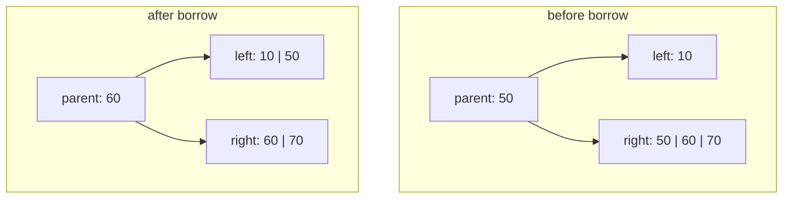

Third, if neither sibling has spare keys, merge the underfull page with a sibling. A separator key is removed from the parent or pulled down, depending on whether this is a B-Tree or B+ Tree internal/leaf merge.

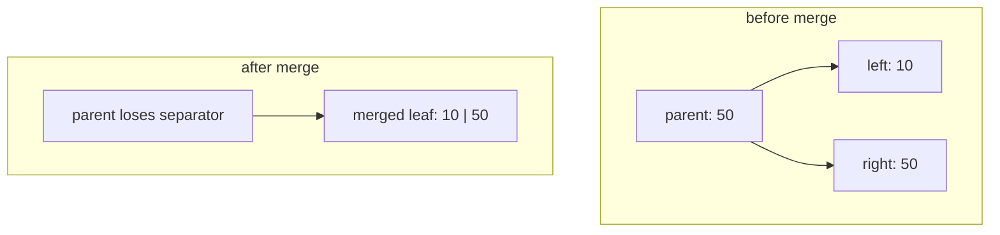

Merging can propagate upward. If the parent underflows after losing a separator, the parent may need to borrow or merge too. If the root ends up with a single child, the tree can shrink by one level.

The main invariant is simple even when the code is not: every leaf must remain at the same depth, and every page except the root must remain sufficiently full.

---

## Why Databases Prefer B+ Trees

Most production row-store indexes are closer to B+ Trees than textbook B-Trees.

The distinction is important:

- A B-Tree can store data pointers in internal nodes and leaves.
- A B+ Tree stores actual row pointers or row payloads only in leaf nodes.
- Internal B+ Tree pages contain routing keys and child page IDs.
- B+ Tree leaves are linked together in key order.

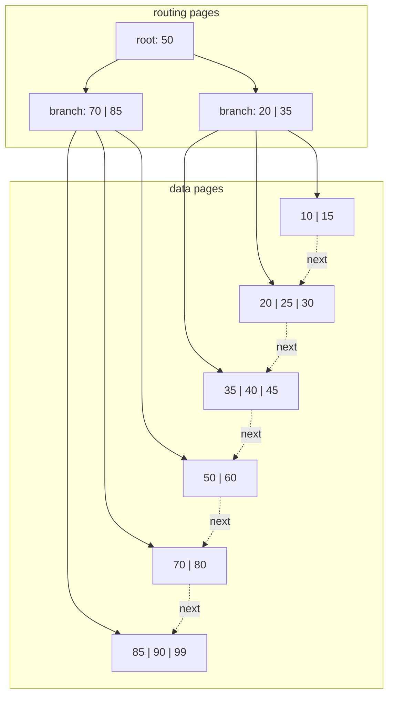

This design has three major benefits.

First, internal pages become smaller and denser. If internal pages contain only keys and child page IDs, they can hold more routing entries. More entries means higher fan-out. Higher fan-out means a shorter tree.

Second, every successful lookup ends at a leaf. That sounds like extra work compared with finding a value in an internal B-Tree node, but it makes behavior consistent. The storage engine always knows where the data pointers live.

Third, range scans become efficient. To answer:

```sql
SELECT *
FROM orders
WHERE created_at >= '2026-07-01'
  AND created_at <  '2026-08-01';
```

the database searches for the first matching key, lands on a leaf, and then walks the leaf-level linked list until the range ends. It does not repeatedly climb up and down the tree.

| Feature        | B-Tree                                    | B+ Tree                               |
| :------------- | :---------------------------------------- | :------------------------------------ |
| Data location  | Internal nodes and leaves may hold values | Values or row pointers live in leaves |
| Internal pages | Routing plus possible values              | Routing only                          |
| Fan-out        | Lower                                     | Higher                                |
| Point lookup   | Fast                                      | Fast and predictable                  |
| Range scan     | Requires tree traversal                   | Leaf chain scan                       |
| Production fit | Useful conceptually                       | Common storage engine shape           |

This is why B+ Trees are the default mental model for database indexes.

---

## What a Page Really Looks Like

A B+ Tree node is not stored as a heap object with slices and pointers. It is serialized into a fixed-size page.

Many storage engines use a slotted page layout. The page header stores metadata. A slot directory grows from the front. Variable-length cells grow from the back. Free space stays in the middle.

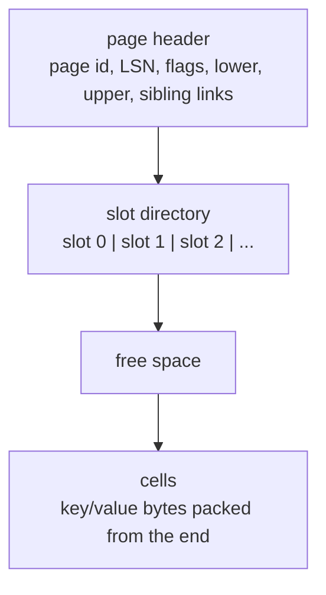

In a simplified physical page:

```text
+-----------------------------------------------------------+
| Page header: LSN, flags, free-space offsets, slot count   |
+-----------------------------------------------------------+
| Slot 0 | Slot 1 | Slot 2 | ...                            |
+-----------------------------------------------------------+
|                    free space                             |
+-----------------------------------------------------------+
| ... | encoded cell 2 | encoded cell 1 | encoded cell 0    |
+-----------------------------------------------------------+
```

The slot directory lets the database keep logical order without constantly moving large key/value cells. If a key is inserted between two existing keys, the engine can insert a small slot entry in sorted order while leaving the cell bytes where they are. If fragmentation gets too high, the page can be compacted.

A leaf page usually stores entries like:

```text
key -> row identifier
```

or, in a clustered index:

```text
primary key -> full row payload
```

An internal page stores entries like:

```text
separator key -> child page id
```

The page header often includes:

- Page type: internal page or leaf page.
- Page LSN: the write-ahead log sequence number needed for recovery.
- Item count and free-space boundaries.
- Right sibling or next leaf pointer.
- Sometimes a high key that marks the upper key boundary of the page.

These fields are not incidental. They are how the tree survives crashes, supports scans, and coordinates concurrent modifications.

---

## Buffer Pool Integration

The tree does not call `read()` for every node visit.

Database engines route page access through the buffer pool. The buffer pool is a cache of database pages in RAM. It knows which disk page is loaded into which memory frame, which frames are dirty, which frames are pinned, and which frames can be evicted.

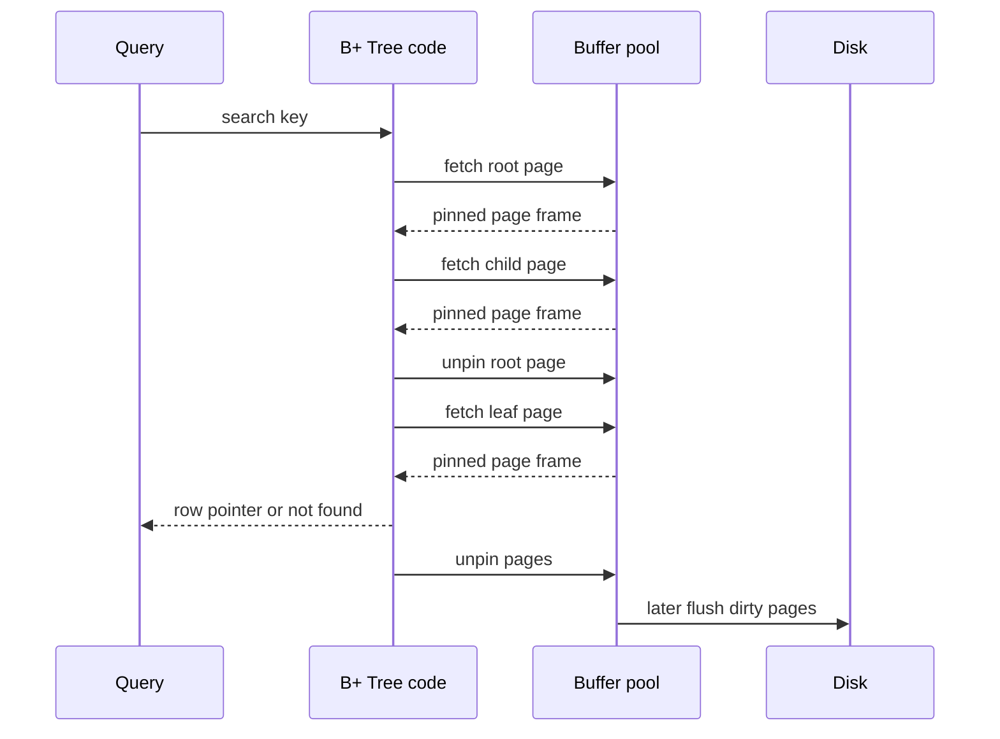

Pinning matters. A pinned page cannot be evicted because some operation is actively using it. Unpinning tells the buffer pool that the operation is done with the page. If the page was modified, it is marked dirty. Dirty pages are written back later, usually coordinated with write-ahead logging so crash recovery can replay or undo changes correctly.

Eviction policies such as LRU, clock, or clock-sweep decide which unpinned pages to remove when the buffer pool needs space. Hot root and branch pages tend to remain cached because many queries touch them.

This is why the top levels of a B+ Tree are often effectively memory-resident even when the full index is much larger than RAM.

---

## Concurrency: Locks Are Not Latches

Database people use "lock" and "latch" for different things.

A lock protects logical database contents for transaction isolation. For example, a transaction may lock a row or key range so another transaction cannot update it in a conflicting way.

A latch protects an in-memory data structure from concurrent physical corruption. For example, a thread may latch an index page while it is reading or splitting that page.

Locks can live for a transaction. Latches should be held for a very short time.

B+ Tree traversal often uses latch crabbing, also called latch coupling. The idea is to hold the parent latch only until the child is safely latched.

For a read:

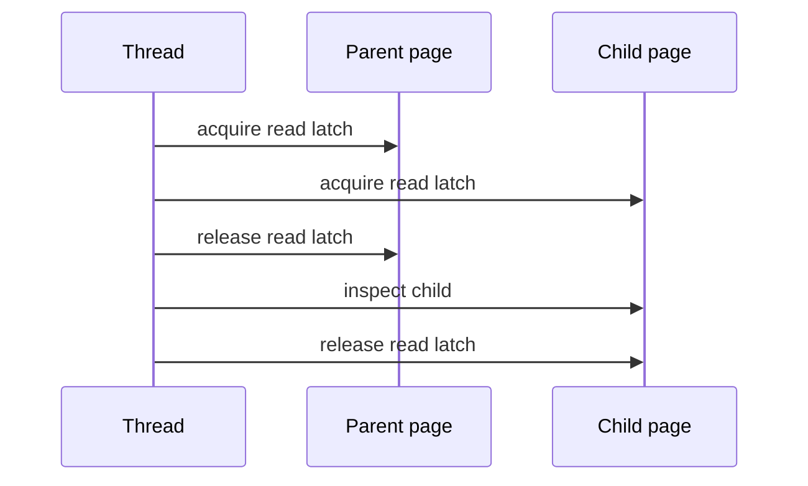

For an insert or delete, the engine may need write latches. The complication is structural modification. If a child might split or merge, the parent may need to be updated. The operation cannot always release ancestors immediately.

A common rule is to ask whether the child is safe:

- For insert, a safe child has enough free space that it will not split.
- For delete, a safe child has enough keys that it will not merge or redistribute.

If the child is safe, ancestor write latches can be released early. If not, the operation may keep latches along the path until it performs the structural change.

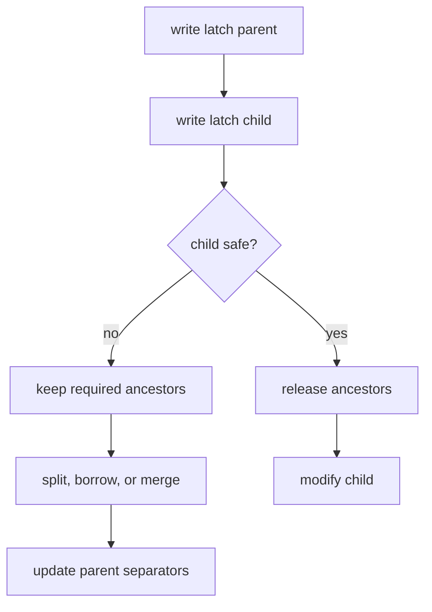

Real engines add more sophistication. Some B+ Tree implementations use right links and high keys so searches can move right when they encounter a page that split concurrently. This reduces how often readers need to block behind structural changes.

---

## Production Examples

The same B+ Tree idea appears differently across storage engines. The useful question is: when the leaf page finds a key, what does it point to?

### MySQL InnoDB: rows live in the primary-key tree

In InnoDB, the table is organized as a clustered B+ Tree on the primary key. The leaf pages of the primary-key index contain the actual row data.

Secondary indexes are also B+ Trees, but their leaves store the secondary key plus the primary-key value. That means a secondary-index lookup often needs two tree traversals:


This is why a covering index can be so useful. If the secondary index contains every column needed by the query, the engine can answer from the secondary index leaf without the second traversal.

The translation of the B+ Tree idea is direct: in InnoDB, the primary-key B+ Tree is not just an index beside the table. It is the table layout.

### PostgreSQL: indexes point into the heap

PostgreSQL makes a different tradeoff. Table rows are stored in a separate heap relation, not inside the primary-key B-tree. A PostgreSQL B-tree leaf entry stores the indexed key and a tuple identifier, usually written as `TID` or `ctid`.

A `TID` is:

```text
(heap block number, line pointer number)
```

The heap block number chooses the table page. The line pointer chooses the item inside that page. That item points to the tuple bytes, which are the row version PostgreSQL must check for MVCC visibility.

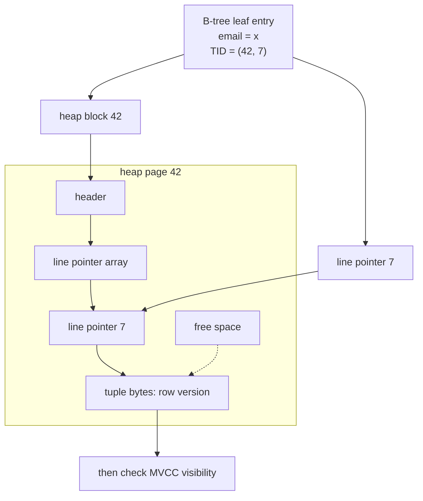

A heap page is PostgreSQL's physical storage unit for table rows. By default it is an `8 KB` block inside the table's heap relation file on disk:

```text
heap relation file on disk
block 0 | block 1 | block 2 | ... | block 42 | ...
```

When a query needs heap block `42`, PostgreSQL asks the buffer manager for that block. If it is already in shared buffers, the query uses the in-memory copy. If not, the storage manager reads the `8 KB` block from the relation file into a shared buffer frame. The executor reads the tuple from that buffer frame, not directly from the disk file.

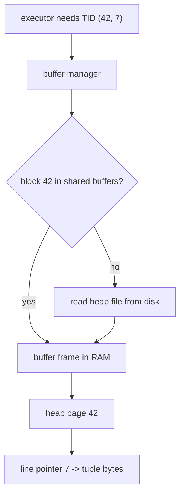

The normal lookup path is therefore:

1. Traverse the B-tree to find matching index entries.
2. Read the `TID` from each leaf entry.
3. Fetch the heap page named by the heap block number.
4. Use the line pointer to find the tuple bytes inside that heap page.
5. Check whether the tuple version is visible to the current transaction.

That last step matters because PostgreSQL uses MVCC. An update usually creates a new tuple version instead of overwriting the old one in place. An index entry can lead to a tuple that exists physically but is not visible to the current transaction snapshot.

PostgreSQL can sometimes avoid the heap visit with an index-only scan. For that to work, the index must contain all columns needed by the query, and PostgreSQL must know that the heap page is all-visible according to the visibility map. Without that visibility information, the engine still needs the heap page to prove whether the row version should be seen by the current transaction.

Large rows add one more detail: PostgreSQL does not split one normal heap tuple across two heap pages. A heap tuple must fit on one page. For large variable-length values such as `text`, `bytea`, `json`, and `jsonb`, PostgreSQL uses TOAST. It may compress the value or move it out of line into a separate TOAST table, leaving a small TOAST pointer in the main heap tuple.

The translation of the B+ Tree idea is different from InnoDB: in PostgreSQL, index leaves usually identify heap tuples; the heap and MVCC rules decide whether those tuples are usable.

### SQLite: the same page-first pressure

SQLite also uses B-tree structures, with table B-trees and index B-trees stored in database pages. The file format is different from both InnoDB and PostgreSQL, but the same storage pressure appears again: make each page read eliminate as much search space as possible.

Across all three systems, the high-level lesson is the same. B+ Trees are not just abstract sorted maps. They are page-routing structures adapted to each engine's row-storage model.

---

## B+ Trees vs. LSM-Trees

B+ Trees are excellent general-purpose indexes, especially when reads and small range scans matter. They are not the only design.

Log-Structured Merge Trees, or LSM-Trees, optimize the write path differently. Instead of updating pages in place, an LSM engine appends writes to a log and an in-memory sorted structure. Later it flushes immutable sorted files to disk and merges them in the background through compaction.

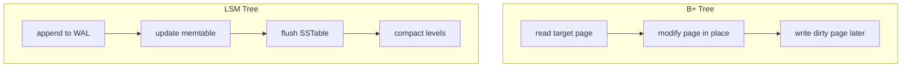

The tradeoff is not "one is better." It is workload-dependent.

| Operation           | B+ Tree                                   | LSM-Tree                                               |
| :------------------ | :---------------------------------------- | :----------------------------------------------------- |
| Point reads         | Predictable and usually fast              | May check memtable, cache, filters, and multiple files |
| Range scans         | Excellent through leaf links              | Good when files are well-compacted, but can span runs  |
| Writes              | Can cause random page writes and splits   | Sequential-friendly writes                             |
| Space behavior      | Page fragmentation and fill factor matter | Compaction can temporarily amplify space               |
| Write amplification | Page rewrites and WAL                     | Compaction rewrites data over time                     |
| Typical systems     | InnoDB, PostgreSQL indexes, SQLite        | RocksDB, LevelDB, Cassandra-style engines              |

B+ Trees update a page near the key. LSM-Trees write somewhere new and clean up later. That is the core difference.

If your workload needs predictable point lookups, ordered scans, uniqueness checks, and transactional updates, a B+ Tree is hard to beat. If your workload is write-heavy and can tolerate compaction behavior and more complex reads, an LSM design can be a better fit.

---

## The Mental Model

A B+ Tree is a page-efficient search machine.

The root and branch pages are routing tables. Each one uses a whole page of sorted separators to eliminate a large portion of the key space. The leaves hold the real entries and link to their neighbors so range scans become linear page walks.

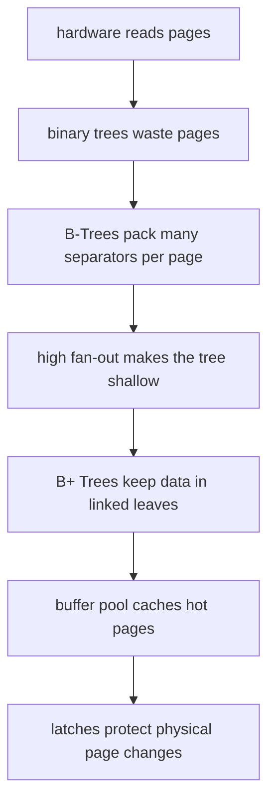

When you see an index in an execution plan, do not picture a tiny abstract tree of individual values. Picture pages:

- A cached root page.
- A few internal pages full of separator keys.
- Leaf pages containing row pointers or rows.
- Linked leaves for ordered scans.
- A buffer pool deciding which pages stay in RAM.
- Write-ahead logging and latches making changes durable and concurrent.

That is the anatomy of database indexing. The elegance of B+ Trees is not that they make `O(log N)` possible. Many trees do that. Their strength is that they make `log N` mean "a few page reads" even when the table has millions or billions of rows.
